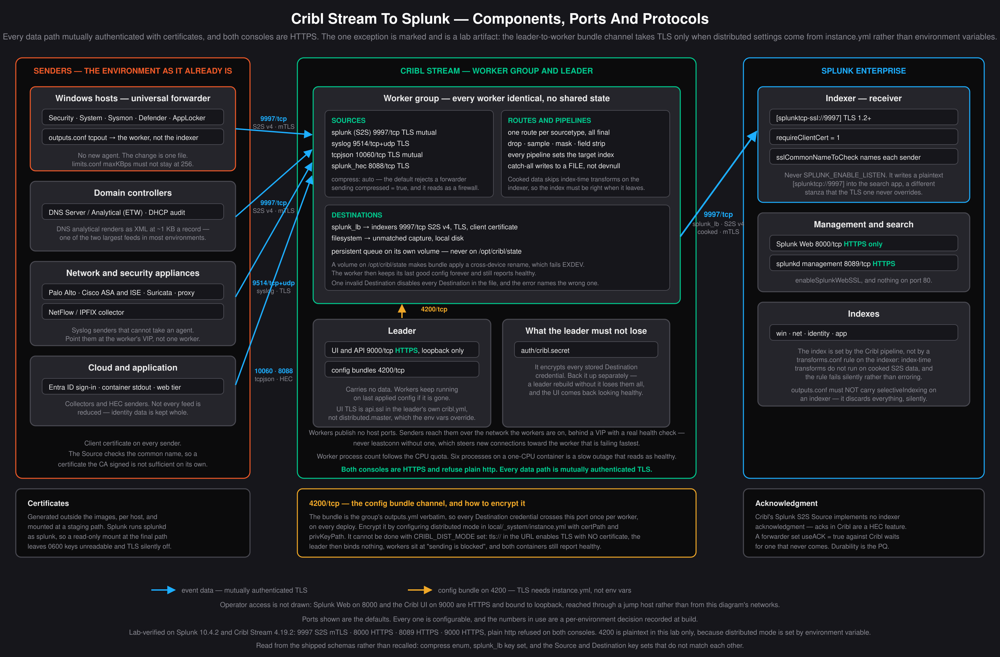

# Windows to Cribl Stream to Splunk: implementation guide

How to collect Windows and network logs through Cribl Stream into Splunk, what
the configuration has to contain, and what each decision costs.

Every Cribl configuration key here was read from the schema shipped inside
`docker.io/cribl/cribl:4.19.2` — the OpenAPI at
`/opt/cribl/default/ui/static/swagger/openapi.json.gz`, the product
documentation under `/opt/cribl/default/ui/static/docs/`, and the function
implementations under `/opt/cribl/default/cribl/functions/`. Splunk keys are
quoted from the `.spec` files in `splunk/splunk-spec-files/`. Behavior that was
verified by running it is marked **verified**; behavior taken from a vendor
document and not run here is marked as such.

---

## Overview

The path is: universal forwarders and network devices send to a Cribl worker
group; the workers reduce, redact and route; the workers send cooked data to the
Splunk indexers. The leader holds configuration and carries no data.

The measured result of running this on fifteen log sources is in
[cribl-value-measured.md](cribl-value-measured.md): 34.4% of licensed volume
removed, with all 37 mapped controls retaining evidence and every full-rate
detection witness left intact. Read that
before sizing anything from this document.

Three properties of the design are worth stating up front because they
constrain everything else:

- **The index must be correct when the event leaves Cribl.** Cooked data skips
  index-time processing on the indexer, so `transforms.conf` rules that set
  `_MetaData:Index` do not run. Every pipeline sets the index itself.
- **Reduction is a coverage decision, not a technical one.** Each source in the
  integration lab declares the controls its events evidence, and the lab fails
  if reduction removes a control's only evidence.
- **A leader outage is not a data outage.** Verified: with the leader stopped,
  a worker accepted 2,000 events over mutual TLS, applied its pipelines and
  delivered them at the normal reduction ratio.

## Requirements

### Software

| Component | Version | Notes |
| --- | --- | --- |
| Cribl Stream | 4.19.2 | Leader plus a worker group. Free license covers one worker group; a Windows group alongside the default group is two. |
| Splunk Enterprise | 10.4.2 | Receiver on `[splunktcp-ssl://9997]` with `requireClientCert`. |
| Splunk Universal Forwarder | 10.4.2 | Already deployed on Windows hosts. Collection moves with one `outputs.conf` change. |

### Certificates

A certificate per sender and per receiver, issued by a CA both ends trust:

- Each forwarder and each network sender presents a client certificate. The
  Cribl Source checks the common name, so a certificate the CA signed is not
  sufficient on its own.
- Each Cribl worker presents a server certificate to senders and a client
  certificate to the indexers.
- Splunk's `sslCommonNameToCheck` on the receiver names every sender that may
  connect. A sender whose common name is absent is refused at the handshake,
  and from the sending side that presents as a network fault.

**Certificates cannot be rotated in place.** Verified: after reissuing a
worker certificate, neither a new TLS handshake nor a configuration deploy
picked up the new one — the worker continued presenting the old certificate
until the process restarted. Rotation is a rolling restart of the worker group.

### Network

| From | To | Port | Protocol |
| --- | --- | ---: | --- |
| Universal forwarders | Cribl workers | 9997 | Splunk S2S v4, mutual TLS |
| Network and security appliances | Cribl workers | 9514 | syslog over TLS |
| Cribl workers | Splunk indexers | 9997 | Splunk S2S v4, mutual TLS |
| Cribl leader | Cribl workers | 4200 | configuration bundles |
| Operators | Cribl leader | 9000 | HTTPS |
| Operators | Splunk Web | 8000 | HTTPS |

Workers publish no ports to the host. Senders reach them over the network the
workers are on, behind a load balancer with an active health check.

### Capacity inputs the operator must supply

This document cannot size a deployment. Four inputs decide it, and none of them
is a property of the software:

1. **Events per second per host class.** Workstation, member server and domain
   controller rates differ by two orders of magnitude.
2. **Average record size**, separately for the wire and for the on-disk
   `.evtx` channel. They are different quantities and are commonly conflated.
3. **The event mix.** The reduction a pipeline achieves is mostly a property of
   what the environment sends it. The per-source table in
   [cribl-value-measured.md](cribl-value-measured.md) exists so these can be
   substituted.
4. **Windows Event Log channel size**, which sets endpoint ride-through during
   an outage. Read back the value stored under
   `HKLM\SYSTEM\CurrentControlSet\Services\EventLog\<channel>` after setting
   it, and measure time-to-rollover directly rather than deriving it.

### Service accounts

splunkd on Windows endpoints needs membership in **Event Log Readers** and the
`SeServiceLogonRight` privilege, with interactive, network and
remote-interactive logon denied by group policy. Splunk documents a domain user
for this. A group managed service account is not documented by Splunk for the
purpose; the per-host virtual account is the supported alternative and carries
an identical privilege set.

---

## Components, ports and protocols



Source: [`topology/components-ports.svg`](topology/components-ports.svg). Regenerate
the PNG with `topology/render-png.sh`.

### Do you still need heavy forwarders?

For the log-shipping path in this design, no. It is worth being precise about
why, because "Cribl replaces the heavy forwarder" is true of most of what an
intermediate tier does and false of one part of it.

A heavy forwarder is a full Splunk Enterprise instance with parsing enabled.
Organizations deploy them for five reasons, and Cribl absorbs four:

| What the heavy forwarder was for | With Cribl |
| --- | --- |
| Cooking — line breaking, timestamp extraction, sourcetype assignment | The `splunk_lb` Destination sends cooked data. The indexer skips the work either way. |
| Index-time filtering and routing — `nullQueue`, `transforms.conf`, `SEDCMD` masking | Pipeline functions, applied where you can see what they removed. |
| Cloning to more than one destination | Native, and to destinations Splunk cannot reach. |
| An intermediate tier for connection aggregation or DMZ traversal | The worker group is that tier. |
| **Running Splunk modular inputs** — add-ons that collect by running inside a Splunk instance | **Not absorbed. See below.** |

The exception is real. A number of Splunk add-ons collect through modular
inputs that only run inside a Splunk process — DB Connect, and the add-ons for
several cloud and SaaS APIs. Cribl ships its own Collectors for many of the same
sources, and where one exists it replaces the add-on outright. Where it does not,
or where a certified add-on is a compliance requirement rather than a technical
one, you keep a Splunk instance to run that input. That instance is a collector,
not a tier in this path: it sends its output to Cribl like any other source.

**A heavy forwarder in front of Cribl is usually worse than none.** It cooks the
data before Cribl sees it, which makes some pipeline work harder; it is another
full Splunk instance to license, patch and manage; and any index-time transform
placed on it conflicts with the rule this design depends on — the index has to
be correct when the event leaves Cribl, because index-time transforms do not run
on cooked data.

**Cribl Edge is a separate question.** It can replace the universal forwarder on
the endpoint itself. This design keeps the universal forwarder deliberately: it
is already deployed on every Windows host, and moving to Cribl is then a change
to one `outputs.conf` rather than a new agent on ten thousand machines.

---

---

# Implementation

Sections 1 through 9 are the build, in the order it is built: the path, then
each component's configuration, then the hardening checklist, the failure modes
that configuration prevents, and the acceptance test that proves it.

## 1. The path end to end

### What the reduction is worth

The lab behind these figures was built to measure one thing: indexed volume,
and therefore license cost, with and without the pipeline. The event IDs it
carries are an example set sized to exercise the pipeline, not a detection
baseline — an environment picks its channels and event IDs from its own threat
model and the analytics it runs.

Splunk licenses on **indexed volume** — the bytes of `_raw` as they land — so
the comparison has to use the same measure twice: `sum(len(_raw))`
for every event the endpoints produce — what a universal forwarder pointed
directly at Splunk would meter — against `sum(len(_raw))` in the index after
the pipeline has run. `cribl/integration-lab/run-lab.sh` measures exactly
that on every run.

Measured over 30,000 records across 15 sources averaging 453 bytes:

| | Licensed volume |
| --- | --- |
| Senders → Splunk, no pipeline | 12.97 MB |
| Senders → Cribl → Splunk | 8.50 MB |
| **Removed** | **34.4%** |

Attribution by rule family:

| Rule | Share of the saving |
| --- | --- |
| Drop Security 5156 / 5158, covered by full-rate Sysmon EventID 3 | 28.6% |
| Sample NetFlow, which duplicates the full-rate firewall log | 25.1% |
| Drop container INFO and DEBUG except lines carrying auth content | 20.2% |
| Sample Suricata flow, keeping every alert and http record | 12.5% |
| Field removal — DNS `PacketData`, ISE `Step=`, proxy user-agent | 10.9% |
| Narrowed web static-asset drop, never a POST | 2.7% |

Shares are of the removed bytes and are measured per sourcetype on the same
run; they sum to 100%.

Six of fifteen sources are reduced by nothing: Palo Alto, Sysmon, ASA, DHCP,
Linux auth and Entra sign-ins. Each is either the only witness to something or
too small for reduction to be worth the coverage risk.

A volume-tuned version of these rules reached 69.8% by sampling Sysmon,
sampling DNS by name, sampling session records, and masking encoded commands in
place. Half the saving is the price of not doing those things.

Projected at the modelled fleet rate of 56,750 EPS, 34.4% removal takes ingest
from **2,071 GB/day to 1,358 GB/day**. At a term-license price of $150 per
GB/day that is $311k against $204k — but the EPS model and the price are both
*inputs*, not measurements, and only the removal figure is

The cost of the saving: every byte removed is a byte no analyst
can search, and no index-time transform on the indexer will bring it back.
5156/5158 are a defensible drop, but that is a decision someone has to
approve, not a technical default.

A second lab run will measure the opposite direction — extending detection
coverage across these sources while holding the storage reduction — so the two
are balanced rather than one traded for the other. Treat the rule set below as
the volume-reduction half of that balance, not as a finished collection
standard.

**The topology is sized from two numbers**, both of which the operator supplies (see Requirements): aggregate ingest, which on the example fleet is 10,000 × 5 + 55 × 50 + 5 × 800 = 56,750 EPS; and sustained events per second per worker process, which sets the worker count. Neither is a property of the software, and the example rates are illustrative. Assertion 20 produces the second and replaces the first.

```
 WINDOWS ENDPOINT (10,000 workstations, 55 servers, 5 DCs)
 ┌──────────────────────────────────────────────────────────┐
 │ Windows Event Log service                                │
 │   Security / System / Sysmon / PowerShell / ...          │
 │   channel .evtx = THE endpoint buffer (see §2)           │
 │        │  EvtQuery, batch_size=10                        │
 │ splunkd (UF 10.4.2), Event Log Readers only              │
 │   renderXml=1 + suppress_* + $XmlRegex denylists         │
 │   [thruput] maxKBps per tier   <-- hard eps ceiling      │
 │   mgmtHostPort 127.0.0.1:8089                            │
 └───────────────┬──────────────────────────────────────────┘
                 │  S2S v4 over TLS 1.2, client cert
                 │  tcp/9997, autoLB over N A-records
                 │  compressed=true + useClientSSLCompression=false
                 ▼
 ┌───────────────────────────────────────────────────────────┐
 │ CRIBL WORKER  (podman, network `data`, NO host ports)     │
 │  Source  in_win_s2s   type: splunk   :9997                │
 │     tls.requestCert + rejectUnauthorized + commonNameRegex│
 │     compress: auto     <-- REQUIRED, see §3               │
 │     pqEnabled: false        <-- deliberate, see §5        │
 │     pipeline: win_redact    <-- Source pre-processing     │
 │        │                                                  │
 │     Routes → win_events ──────────────► out_splunk_lb     │
 │            → quarantine  ─────────────► out_splunk_lb     │
 │                                                           │
 │  Destination out_splunk_lb  type: splunk_lb               │
 │     onBackpressure: queue                                 │
 │     pqPath: /opt/cribl/pq   <-- own volume, NOT state/    │
 └───────────────┬───────────────────────────────────────────┘
                 │  S2S v4 over TLS 1.2, client cert
                 │  COOKED + PARSED (index/sourcetype/_time set)
                 ▼
 ┌──────────────────────────────────────────────────────────┐
 │ SPLUNK ENTERPRISE 10.4.2                                 │
 │  [splunktcp-ssl://9997] requireClientCert=1              │
 │     connection_host = none, queueSize = 8MB              │
 │  server.conf [queue=splunktcpin] maxSize = 64MB          │
 │  indexes: win_security / win_system / win_script /       │
 │           win_quarantine                                 │
 │  apps: Splunk_TA_windows  (already in-tree, not deployed)│
 └──────────────────────────────────────────────────────────┘

 CONTROL PLANE (must be closed before any credential is stored)
   leader:4200  tls://  — carries the whole config bundle
   leader:9000  UI, loopback-bound
```

Ports: 9997/tcp UF→worker (worker-internal, `data` network only). 9997/tcp worker→indexer. 4200/tcp leader↔worker. 9000/tcp leader UI, `127.0.0.1` only. 8089/tcp splunkd management, `127.0.0.1` only on endpoints.

---

## 2. Endpoint collection

**Splunk Universal Forwarder 10.4.2 on the general fleet. Cribl Edge only where you want fleet-side JavaScript. WEF/WEC only where no agent is permitted.**

Three technical reasons, not preference:

1. **It is already deployed.** Moving collection to Cribl is a change to one
   `outputs.conf` on hosts that already run the agent, not a new agent on ten
   thousand machines.
2. **`$XmlRegex` filtering discards an event before it is read.** That is
   stronger than redacting it downstream: the data never leaves the host, so
   there is no window in which it exists in transit or in a queue.
3. **It adds one outbound trust relationship.** A client certificate to the
   worker, rather than a second control plane with management access to every
   endpoint.

**Cribl Edge** is a supported alternative: `win_event_logs` is a Source type in
4.19.2, and the shipped documentation states that Edge Workers support Windows
Event Logs only when running on Windows. Adopting it requires a Fleet
(`default_fleet` exists in `leader-config/groups.yml`) and a second bind mount
on the leader mirroring `group-default`. It is a reasonable choice on the small
number of hosts that produce most of the volume and a poor one across the whole
fleet, where it replaces a deployed agent with a new one for no collection gain.

**Windows Event Forwarding** terminates directly in Cribl — `wef` is a Source
type. Note the latency before choosing it for anything with an alert attached:
a Normal subscription batches on a 15-minute timer, and Minimize Latency is 30
seconds.

### The endpoint app: `splunk/deployment-apps/TA-win-cribl-fwd/`

This is a *Windows* app. It is not mounted by any compose file in this tree, and it should not be — you copy it to `%SPLUNK_HOME%\etc\apps\` on the endpoint. Saying otherwise would make it inert.

`default/inputs.conf` — the two-policy channel design:

```ini
# ---------------------------------------------------------------
# Security: DEFAULT-ALLOW with explicit noise removal.
# New detections arrive as NEW event IDs. A whitelist on Security
# is a standing promise to be blind to whatever Microsoft ships next.
# ---------------------------------------------------------------
[WinEventLog://Security]
disabled = 0
renderXml = 1
suppress_text = 1
suppress_sourcename = 1
suppress_keywords = 1
suppress_task = 1
suppress_opcode = 1
evt_resolve_ad_obj = 0
current_only = 0
start_from = oldest
batch_size = 10
index = win_security
sourcetype = XmlWinEventLog
source = XmlWinEventLog:Security
# Windows Filtering Platform. 60-80% of Security volume on any host
# with connection auditing on, and it carries no detection the network
# layer does not carry better.
blacklist1 = $XmlRegex="<EventID>(?:5152|5153|5156|5158)<\/EventID>"
# Handle open/close/duplicate churn.
blacklist2 = $XmlRegex="<EventID>(?:4656|4658|4690|4670)<\/EventID>"
# Directory property-level reads that are not GPO.
blacklist3 = $XmlRegex="<EventID>(?:4662|566)<\/EventID>.+<Data Name='ObjectType'>(?!groupPolicyContainer)"
# Splunk's own binaries creating processes (self-noise feedback loop).
blacklist4 = $XmlRegex="<EventID>(?:4688|4689)<\/EventID>.+(?i)(?:[C-F]:\\(?:Program Files\\)?Splunk(?:UniversalForwarder)?\\)"

# ---------------------------------------------------------------
# Everything else: DEFAULT-DENY by event ID. These channels are
# mostly operational noise with a handful of gold events, and the
# gold is enumerable.
# ---------------------------------------------------------------
[WinEventLog://System]
disabled = 0
renderXml = 1
suppress_text = 1
suppress_sourcename = 1
suppress_keywords = 1
suppress_task = 1
suppress_opcode = 1
current_only = 0
index = win_system
sourcetype = XmlWinEventLog
source = XmlWinEventLog:System
whitelist1 = $XmlRegex="<EventID>(?:104|1074|6005|6006|6008|7030|7040|7045)<\/EventID>"

[WinEventLog://Microsoft-Windows-Sysmon/Operational]
disabled = 0
renderXml = 1
suppress_text = 1
suppress_sourcename = 1
suppress_keywords = 1
suppress_task = 1
suppress_opcode = 1
current_only = 0
checkpointInterval = 0
index = win_system
sourcetype = XmlWinEventLog
source = XmlWinEventLog:Microsoft-Windows-Sysmon/Operational

[WinEventLog://Microsoft-Windows-PowerShell/Operational]
disabled = 0
renderXml = 1
suppress_text = 1
suppress_sourcename = 1
suppress_keywords = 1
suppress_task = 1
suppress_opcode = 1
current_only = 0
index = win_script
sourcetype = XmlWinEventLog
source = XmlWinEventLog:Microsoft-Windows-PowerShell/Operational
whitelist1 = $XmlRegex="<EventID>(?:4100|4103|4104)<\/EventID>"

# TaskScheduler, WinRM, WMI-Activity, CodeIntegrity, Defender,
# TerminalServices-LocalSessionManager: same shape, whitelisted IDs.
```

**`renderXml = 1` is not optional in this repository.** `splunk/apps/Splunk_TA_windows/props.conf` is keyed entirely on `[XmlWinEventLog]` and `[source::XmlWinEventLog:Security]` / `[source::XmlWinEventLog:System]`. Classic rendering matches none of it: the 4624/4768/4776 authentication lookups, the 5136 Change mapping, and `LOOKUP-user_id = windows_sid` all fail to apply. And every `$XmlRegex` filter in that TA's `inputs.conf` — five working stanzas, eleven filter lines — is only honoured when `renderXml` is true (`inputs.conf.spec:2792-2795`). A rejected filter key filters nothing and fails silently.

The classic-vs-XML byte comparison also runs the other way from intuition: classic rendering includes the full human-readable Message paragraph, which is the dominant term. `renderXml=1` with `suppress_text=1` drops precisely that block. The spec's own guidance (`inputs.conf.spec:2789-2791`) is to pair `renderXml` with all five `suppress_*` "to improve thruput performance."

**`$XmlRegex`, not `$xmlRegex`.** The spec is internally inconsistent — the valid-keys list says `$XmlRegex` (line 2764), the `renderXml` paragraph says `'$xmlRegex'` (line 2794). The repository already answers it: `splunk/apps/Splunk_TA_windows/inputs.conf` uses `$XmlRegex` in five stanzas and its README documents the XML-compatibility patch. Use `$XmlRegex`.

**`evt_exclude_fields` is inert here.** `inputs.conf.spec:2623`: *"Does not effect event report if 'renderXML' is set to 'true'."* It is not a reduction lever on this path. Do not reach for it.

**`evt_resolve_ad_obj = 0`, and the reason is exposure, not speed.** Setting it to 1 makes every workstation bind a domain controller per event — a directory-read primitive on 10,000 machines, and an attacker's enumeration tool on any one of them. The spec also warns that *"the rate at which the input reads events on high-traffic Event Log channels can decrease."* The replacement is already in this tree: `props.conf` line 39, `LOOKUP-user_id = windows_sid user_id OUTPUTNEW user`. Resolve at search time.

**`current_only = 0` explicitly on every stanza.** The spec default is already false (`inputs.conf.spec:2454-2476`), but write it anyway, because `current_only = 1` punches a permanent hole exactly the width of any outage — on that one channel, while every other channel backfills. That asymmetry is the hardest gap class to spot in a dashboard.

**`checkpointInterval` — leave it at the default.** `inputs.conf.spec:2492` states `Default: 0`. Zero is not "never"; it means the input does not defer the checkpoint. Setting `5` *increases* the replay window to five seconds. Any design that presents 5 as an improvement over a supposed 10-second default has the direction inverted.

### `default/limits.conf` — the forwarder throughput ceiling

```ini
[thruput]
# limits.conf.spec:4528-4529 - Default (Splunk Enterprise): 0 (unlimited)
#                              Default (Universal Forwarder): 256
# 256 KBps at ~1.2 KB/event is a ~213 eps ceiling PER INGESTION PIPELINE.
# A domain controller at 800 EPS forwards about a quarter of what it
# generates, permanently, and the backlog never drains.
maxKBps = 3072
```

Tiered, because "unlimited" on a DC lets a post-outage backfill saturate the NIC:

**MODELLED — replace after assertion 20.** Every number in this table is derived from two unmeasured inputs, the per-tier EPS and ~1.2 KB/event.

| Tier | modelled EPS | ~KB/s at 1.2 KB | `maxKBps` | note |
|---|---|---|---|---|
| Workstation | 5 | 6 | `512` | 85x headroom for backfill |
| Member server | 50 | 60 | `1024` | |
| Domain controller | 800 | 960 | `3072` | 3x for backfill; **default 256 is 26% of steady state** |

`limits.conf.spec:4519-4521`: *"The thruput processor applies the 'maxKBps' setting for each ingestion pipeline. If you configure multiple ingestion pipelines, the processor multiplies the 'maxKBps' value by the number of ingestion pipelines."* On a DC you may prefer `server.conf [general] parallelIngestionPipelines = 2` with `maxKBps = 1536` — same ceiling, two independent pipelines, and a stall in one does not stop the other.

### `default/outputs.conf`

```ini
[tcpout]
defaultGroup = cribl_win
# -1 blocks rather than drops. NOTE: "0ms"/"0s"/"0m" (with a unit) DROPS
# immediately; bare 0 and -1 block. Use -1 and remove the ambiguity.
dropEventsOnQueueFull = -1

[tcpout:cribl_win]
# One A record per Cribl worker. NOT a VIP: workers publish no host ports
# (compose fact 6), a VIP hides worker failure behind one healthy address,
# and a leastconn balancer without active health checks sends more new
# connections to a failing member, because a member that is dropping
# connections holds the fewest open ones and is selected first.
server = cribl-win-01.example.com:9997, cribl-win-02.example.com:9997
autoLBFrequency = 30
autoLBVolume = 4194304
useACK = true
# LEAVE maxQueueSize AT ITS DEFAULT ("auto").
# outputs.conf.spec:349-380 - with useACK=true, auto is a 7MB output queue
# plus a 21MB wait queue. Setting maxQueueSize=512MB with useACK=true asks
# a workstation for 512MB + 1536MB = 2 GB of RAM. This is a common way to
# exhaust endpoint memory while trying to make forwarding resilient.
compressed = true
useClientSSLCompression = false
clientCert = $SPLUNK_HOME\etc\auth\win-uf.pem
sslRootCAPath = $SPLUNK_HOME\etc\auth\ca.pem
sslVerifyServerCert = true
sslCommonNameToCheck = cribl-worker
sslVersions = tls1.2
```

`compressed = true` **paired with** `useClientSSLCompression = false` is the correct combination and it is not obvious. `outputs.conf.spec:764-773`: `useClientSSLCompression` defaults to **true**, and `compressed = true` only takes effect over TLS *"if either 'useClientSSLCompression' has a value of 'false' or the TLS/SSL connection does not use 'zlib' compression."* Leaving `useClientSSLCompression` at its default makes `compressed = true` a no-op.

**This pairing has a Cribl-side prerequisite. Omitting it silently breaks the pipeline.** The Splunk TCP Source's `compress` setting defaults to **Disabled**, and the shipped docs say so explicitly: *"If upstream Splunk Forwarders are configured to send compressed S2S v4 traffic (for example, `compressed = true` in outputs.conf), setting Compression to Disabled will cause Cribl Stream to reject the connection."* You must set `compress: auto` on the Source. See §3.

### `default/web.conf` and the never-collect list

```ini
[settings]
mgmtHostPort = 127.0.0.1:8089
```

A UF's splunkd REST port is a remote command surface. Nothing in this design needs it reachable.

Never collected — enforced at the UF, before anything is read into a buffer:

- **`admon://`** — dumps Active Directory object contents.
- **`WinRegMon://`** on `HKLM\SECURITY`, `HKLM\SAM`, `HKCU\...\Credentials`.
- **`monitor` / `MonitorNoHandle` on `*.dmp`, `*.hiv`, `*.pfx`, `*.kdbx`.** A forwarded LSASS minidump is a credential dump you have replicated into your SIEM and put under a seven-year retention policy.

Everything else sensitive — 4688 command lines, 4104 script blocks — **must** be collected, and therefore **must** be redacted at Cribl. An endpoint cannot be trusted to redact its own compromise.

### The splunkd service account

Domain user (or per-host virtual account) with: membership in the local **Event Log Readers** group — the only privileged thing it needs — plus `SeServiceLogonRight`. Deny `SeInteractiveLogonRight`, `SeNetworkLogonRight`, `SeRemoteInteractiveLogonRight` by GPO. Not Administrators, not `SeDebugPrivilege`, not `SeBackupPrivilege`. Splunk documents a domain user in Event Log Readers; a gMSA specifically is not documented and should be tested rather than assumed — the privilege set is identical either way.

**No deployment server on tier-0.** A deployment server is authenticated-by-token remote code execution on every client it owns, because scripted inputs are just commands. Push the DC and PKI app by the mechanism that patches those hosts.

### Channel sizing — the actual last line of defence

The `[WinEventLog://]` input holds a checkpoint and reads forward. It does not queue in the agent. When forwarding stalls, the checkpoint stops advancing and the events stay in the `.evtx`. **The Windows event channel is the endpoint buffer, so endpoint ride-through is a GPO question, not an agent question.**

**MODELLED — replace after assertion 20**, and note that the "holds" columns additionally assume on-disk `.evtx` bytes equal rendered-XML wire bytes, which is a third unmeasured input. See open item 11.

| Tier | EPS | channel write rate | 20 MB default holds | 4 GB holds |
|---|---|---|---|---|
| Workstation | 5 | ~6 KB/s | ~55 min | ~7.7 days |
| Member server | 50 | ~60 KB/s | ~5.5 min | ~18 hours |
| **Domain controller** | **800** | **~960 KB/s** | **~21 seconds** | **~1.2 hours** |

**A domain controller on the default 20 MB channel has ~21 seconds of buffer.** That row is the design constraint and it is why the durable buffer lives in Cribl's PQ, not on the endpoint.

`Computer Configuration > Policies > Administrative Templates > Windows Components > Event Log Service > <channel> > Specify the maximum log file size (KB)`, with `Retention = 0` (overwrite as needed). **The registry `MaxSize` value is in kilobytes; `wevtutil sl <channel> /ms:<n>` is in bytes.** Confusing them is a 1000x under-provision that only surfaces during the outage it was meant to cover.

---

## 3. Cribl Sources

New worker group `windows` at `./group-windows` → `/opt/cribl/groups/windows/local/cribl` (fact 2 — files under `local/cribl/groups/<g>/` are silently ignored).

`group-windows/inputs.yml`:

```yaml
inputs:
  in_win_s2s:
    type: splunk
    disabled: false
    host: 0.0.0.0
    port: 9997
    maxS2Sversion: v4

    # REQUIRED, and the least obvious line in this file.
    # The Source's default is 'disabled', which REJECTS compressed S2S v4
    # connections outright. With compressed=true on the UF, leaving this
    # unset means every forwarder connection is closed on handshake.
    compress: auto

    useFwdTimezone: true       # gives Event Breakers __TZ from UF metadata
    dropControlFields: true    # discard crcSalt / _savedPort
    extractMetrics: false      # no Splunk metric events on this path

    # Default is 1000 per Worker Process. Size for the DEGRADED case, not
    # the average: if 6 of 8 workers are gone, all forwarders land on 2.
    maxActiveCxn: 2000
    socketIdleTimeout: 0
    socketMaxLifespan: 3600
    staleChannelFlushMs: 10000

    # Narrow this to the endpoint supernet. /.*/ is the shipped default.
    ipWhitelistRegex: /^10\.20\.|^10\.21\./

    # Deliberately OFF. See section 5 - a source-side PQ stops
    # backpressure at Cribl's disk and throws away the endpoint's channel,
    # which is the largest free buffer in the system.
    pqEnabled: false

    sendToRoutes: true

    # Redaction on the SOURCE, not on a Route. Three consequences, all
    # security ones: a Route-level mask is bypassed the moment someone
    # inserts a Route above it; it does not protect what lands in the
    # persistent queue during an indexer outage; and it does not cover a
    # Destination someone adds for debugging.
    pipeline: win_redact

    tls:
      disabled: false
      requestCert: true
      rejectUnauthorized: true
      # Matches on the substring after CN=. If the peer cert has SAN
      # entries, Cribl checks the regex against those and IGNORES the CN.
      commonNameRegex: /^win-uf\.corp\.example\.com$/
      certPath: /opt/cribl/certs/cribl-worker.crt
      privKeyPath: /opt/cribl/certs/cribl-worker.key
      caPath: /opt/cribl/certs/ca.crt
      minVersion: TLSv1.2

    # Optional second factor. Contrary to a common claim, S2S in Cribl
    # DOES support a shared secret: "Shared secrets to be provided by any
    # Splunk forwarder. If empty, unauthorized access is permitted."
    # authTokens:
    #   - token: <generated>
    #     description: win-uf fleet

  # in_win_hec: a HEC fallback is NOT shipped here. `InputSplunkHec` requires
  # ['type','host','port','splunkHecAPI']; a type-only stub with disabled: true
  # is invalid config, not an inert placeholder, and one invalid entry takes
  # every Source in this file with it. Write all four keys or write nothing.
```

Every key above is from the shipped 4.19.2 OpenAPI schema `InputSplunk`, whose `required` list is `['type','host','port']`. The `certPath`/`privKeyPath`/`caPath` form is confirmed by `TlsSettingsServerSideType` — *"Path on server containing certificates to use. PEM format. Can reference `$ENV_VARS`."* — which fits this repo, where `./certs` is already bind-mounted read-only at `/opt/cribl/certs` and `generate_cert.py` is already on the deploy path and already asserted by `uat.sh`. `certificateName` (a named certificate from `certificates.yml`) is the alternative; both exist.

`minVersion` accepts `TLSv1`, `TLSv1.1`, `TLSv1.2`, `TLSv1.3`. `TLSv1.2` is the interoperable floor — the Splunk 10.0.0 `outputs.conf.spec` lists only up to `tls1.2`.

### The worker-process defect, and the fix that actually lands

This is live in this repository right now. Read off the running container:

```
$ podman inspect -f '{{.HostConfig.NanoCpus}} {{.HostConfig.Memory}}' cribl_workers_2
1000000000 2147483648                        # 1.0 CPU, 2 GB

$ podman exec cribl_workers_2 nproc
8                                            # host cores, not the quota

$ podman exec cribl_workers_2 cat /opt/cribl/default/cribl/cribl.yml
workers:
  count: -2                                  # "host cores minus 2" = 6
  minimum: 2
  memory: 2048                               # MB of V8 heap, PER PROCESS

$ podman exec cribl_workers_2 ps -eo rss,args --no-headers | grep 'r WORKER'
248404 ... cribl.js server -r WORKER -i 0
248712 ... -i 1
239132 ... -i 2
248968 ... -i 3
245376 ... -i 4                              # -i 5 is GONE

$ podman exec cribl_workers_2 cat /sys/fs/cgroup/memory.current
1132384256                                   # 1.13 GB of 2 GB, ZERO traffic
```

Six worker processes requested on a 1.0-CPU container. Six log directories exist (`log/worker/0` … `log/worker/5`). Twelve `"worker process exited, removing"` entries in `log/cribl.log`; `w:5` exited at 22:38:42 and was never respawned. The container has run for the last 57 minutes with five processes where the config asks for six, at 1.13 GB of a 2 GB cap with no data flowing — and the leader lists it healthy the whole time. Nominal heap ceiling: 6 × 2048 MB = 12 GB inside a 2 GB container.

**No sizing number in any design means anything until this is fixed.** The fix is not what the PERFORMANCE candidate proposed. A `cribl.yml` in the group directory *probably* is distributed — `WorkersTypeSystemSettingsConf` in the OpenAPI is exactly this block (`count`, `minimum`, `memory`, `loadThrottlePerc`, `restartUnresponsiveProcesses`, `enableHeapSnapshots`), reachable at `PATCH /m/<group>/system/settings/conf`, and the distribution artifact is `/opt/cribl/state/distributed/bundles/<group>/bundle.<sha>.tgz`, whose `local/` layer is copied from the group directory **wholesale, with no filename allowlist** — `inputs.yml.template` and `outputs.yml.template`, which are not Cribl config at all, ride into the bundle unchanged. The worker's applied `/opt/cribl/local/cribl/` holds `auth/`, `conf-version.yml`, `cribl.inited`, `inputs.yml`, `inputs.yml.template`, `insights.yml`, `messages.yml`, `outputs.yml`, `outputs.yml.template` and `pipelines/`. There is no `cribl.yml` there — but there is none to distribute either: no group on the leader has a local-layer `cribl.yml`, so this is "none authored", not "suppressed". A headline fix still should not rest on the one step that remains inference.

There is a mechanism in this image that is verifiable and does not depend on distribution at all. `/sbin/entrypoint.sh` contains:

```bash
for f in $(find /opt/cribl.d -name "before-*.sh" -type f | sort); do
    . "$f"
done
```

and `/opt/cribl.d/` exists in the image, empty. A drop-in that rewrites `/opt/cribl/default/cribl/cribl.yml` before Cribl starts is deterministic, is a file rather than a `CRIBL_*` variable, and survives bundle apply — because bundle apply renames over `local/cribl`, never `default/`.

`cribl/cribl.d/before-10-worker-procs.sh`:

```bash
#!/usr/bin/env bash
# Pin Cribl's worker-process count to this CONTAINER's CPU quota.
#
# The shipped default is `count: -2` = "host cores minus 2", and Cribl
# counts HOST cores, not the cgroup quota. On this repo's 8-core host a
# 1.0-CPU / 2 GB worker spawns SIX processes with a 2048 MB heap ceiling
# each - 12 GB of nominal heap in a 2 GB container - and reports healthy.
#
# Not a bind mount into /opt/cribl/local/cribl: a worker applies a bundle
# by renaming over that directory, and a mount there makes rename(2) fail
# the same way a volume on /opt/cribl/state does.
set -u
C="${IR_WORKER_PROCS:-2}"
M="${IR_WORKER_HEAP_MB:-1024}"
F=/opt/cribl/default/cribl/cribl.yml
awk -v c="$C" -v m="$M" '
  /^workers:/ { print "workers:"; print "  count: " c; print "  minimum: " c;
                print "  memory: " m; print "  restartUnresponsiveProcesses: true";
                inb=1; next }
  inb && /^[ \t]/ { next }
  { inb=0; print }
' "$F" > /tmp/cribl.yml.new && cat /tmp/cribl.yml.new > "$F"
echo "{\"cid\":\"container\",\"channel\":\"entrypoint\",\"level\":\"info\",\"message\":\"pinned workers.count=${C} memory=${M}MB\"}"
```

Mounted read-only at `/opt/cribl.d/before-10-worker-procs.sh` on both leader and workers. Sizing rule:

```
IR_WORKER_PROCS   = floor(WORKER_CPUS)              , minimum 1
IR_WORKER_HEAP_MB = (WORKER_MEMORY_MB - 512) / PROCS, capped at 2048
```

| `WORKER_CPUS` | `WORKER_MEMORY` | `IR_WORKER_PROCS` | `IR_WORKER_HEAP_MB` | nominal ceiling |
|---|---|---|---|---|
| 1 | 2g | 1 | 1024 | 1.5 GB in 2 GB |
| 2 | 4g | 2 | 1536 | 3.5 GB in 4 GB |
| 4 | 8g | 4 | 1792 | 7.7 GB in 8 GB |

Assertion 3 in §9 measures the process count directly. Nothing downstream of this is trustworthy until it passes.

---

## 4. Cribl routes and pipelines

### The parsing question, settled

`serde` (the Parser function) has **no XML type**. Its enum, read from `/opt/cribl/default/cribl/functions/serde/conf.schema.json`, is `auto, csv, elff, clf, kvp, json, delim, regex, grok`. `xml_unroll` splits one XML document into many events; it is not a field extractor. There is no cheap first-class way to turn Windows EventLog XML into fields inside Cribl, and there is no reason to want one: `Splunk_TA_windows` already does search-time extraction for `XmlWinEventLog:*`.

So: **extract only what a decision needs.** The per-event budget framing from the PERFORMANCE design carries: a full XML parse measured 22.3 µs against 0.27 µs for an anchored `EventID` extract. Those two numbers are the entire argument. They are inherited measurements; assertion 9 in §9 re-measures them on this stack.

### Field naming: use `__` prefixes, and this is not cosmetic

Cribl's `splunk_lb` Destination sends **cooked and parsed** events, and its `nestedFields` setting is described as *"How to serialize nested fields into index-time fields."* Any ordinary field you create in the pipeline becomes an **index-time field** in Splunk — bloating the index and colliding with the TA's search-time extraction of the same name. Fields prefixed `__` are Cribl-internal and are never emitted. (Corroborated in `functions/mask/index.js`, which branches on `e.startsWith("__")` to classify internal fields.) Extract into `__ec`, `__chan`, `__host`; never into `EventCode`.

### `group-windows/pipelines/win_redact/conf.yml` — Source pre-processing

```yaml
asyncFuncTimeout: 1000
functions:
  # fields: ['_raw'] - exactly one simple field name - takes the
  # singleSimpleField fast path in functions/mask/index.js and skips the
  # event tree traversal entirely. Adding a second field name costs a
  # full __traverseAndUpdateWithInternalFields on every event.
  - id: mask
    disabled: false
    filter: "__ec === '4688' || __ec === '4103' || __ec === '4104' || __chan === 'Microsoft-Windows-PowerShell/Operational'"
    conf:
      fields: ['_raw']
      depth: 1
      rules:
        # Password on a command line, quoted or bare.
        - matchRegex: /((?:\/|-{1,2})(?:p|pw|pass|passwd|password)[:= ]\s*)("[^"]{1,256}"|'[^']{1,256}'|\S{1,256})/gi
          replaceExpr: "`${g1}<redacted>`"
        # net user <name> <password>  /  net use ... /user:x <password>
        - matchRegex: /(\bnet\s+us(?:er|e)\s+\S{1,64}\s+)(?!\/)(\S{1,128})/gi
          replaceExpr: "`${g1}<redacted>`"
        # PowerShell secure-string literals.
        - matchRegex: /(ConvertTo-SecureString\s+(?:-String\s+)?)("[^"]{1,512}"|'[^']{1,512}'|\S{1,512})/gi
          replaceExpr: "`${g1}<redacted>`"
        # Long high-entropy tokens after an obvious key name.
        - matchRegex: /((?:api[_-]?key|secret|token)["'\s:=]{1,4})([A-Za-z0-9+\/=_\-]{24,})/gi
          replaceExpr: "`${g1}<redacted:${g2.length}>`"

  # An ordinary (non-__) field, so it reaches Splunk as an index-time
  # field. Present only when a rule fired, so the cardinality is trivial
  # and `index=win_* cribl_redacted=true` proves redaction is live in
  # production rather than only in the test.
  - id: eval
    disabled: false
    filter: "_raw.indexOf('<redacted') !== -1"
    conf:
      add:
        - name: cribl_redacted
          value: "true"
```

The `g1` / `g2` capture-group variable names are **verified in-image**, not from memory. `functions/mask/index.js` builds the replace context as `{g0: <full match>, event: <event>}` and then `l['g'+n]` for each group. A broken `replaceExpr` on a credential rule fails toward leaking, not toward erroring, so this one was worth confirming.

The masks run *before* the drop rules, on 4688/4103/4104 only — the events that carry secrets. They cost ~2.5 µs each (inherited measurement) on a small fraction of the stream.

**Why the Source and not a Route.** A Route-level mask is bypassed the moment someone inserts a Route above it; it does not protect what lands in the persistent queue during an indexer outage; and it does not cover a Destination someone adds for debugging. Source pre-processing runs before Routes, before the PQ, and before every Destination.

### `group-windows/pipelines/win_events/conf.yml`

```yaml
asyncFuncTimeout: 1000
functions:

  # 1. Extract ONLY what the drop and route rules need. Three anchored
  #    matches, results into __ fields so nothing leaks to the index.
  #    iterations: 1 - stop after the first match per regex rather than
  #    rescanning the remaining 1.2 KB (default is 100).
  - id: regex_extract
    disabled: false
    filter: "true"
    conf:
      source: _raw
      iterations: 1
      regexList:
        - regex: /<EventID[^>]*>(?<__ec>\d{1,5})<\/EventID>/
        - regex: /<Channel>(?<__chan>[^<]{1,120})<\/Channel>/
        - regex: /<Computer>(?<__host>[^<]{1,255})<\/Computer>/

  # 2. Drop on the EXTRACTED event code, never on _raw.includes(...).
  #    _raw.includes('EventCode=5156') false-positives on any event whose
  #    Message quotes that string - and 4104 script blocks quote anything.
  #    A regex literal in an expression is compiled once by V8; an array
  #    .includes() allocates per event.
  - id: drop
    disabled: false
    filter: "/^(4658|4690|4674|4985|5379|4799|5152|5153|5156|5158)$/.test(__ec)"
    conf: {}

  # 3. Second-field extraction, GATED so it runs on 4624 only (~15% of
  #    Security). Ungated this would cost the bounded two-field 4624
  #    regex (1.09 us inherited) on every event for no reason.
  - id: regex_extract
    disabled: false
    filter: "__ec === '4624'"
    conf:
      source: _raw
      iterations: 1
      regexList:
        - regex: /Name='LogonType'>(?<__lt>\d{1,2})</
        - regex: /Name='TargetUserName'>(?<__tu>[^<]{0,256})</

  # 4. Machine-account network logons: the single largest remaining slice
  #    of Security after the WFP drop. Keep interactive and keep human
  #    network logons; drop COMPUTER$ over the network.
  - id: drop
    disabled: false
    filter: "__ec === '4624' && __lt === '3' && __tu && __tu.endsWith('$')"
    conf: {}

  # 5. Sample the two events that are high volume AND occasionally useful.
  - id: sampling
    disabled: false
    filter: "true"
    conf:
      rules:
        - filter: "__ec === '4672'"     # special privileges assigned
          rate: 10
        - filter: "__ec === '5140'"     # network share accessed
          rate: 5

  # 6. Set the routing metadata Splunk will store verbatim.
  #    This is where index containment lives, and it has to be here:
  #    splunk_lb sends COOKED, PARSED events, and cooked data bypasses
  #    the indexer's index-time transform pipeline. An indexes-side
  #    transforms.conf re-derivation would never fire.
  #    (There is also no readable SOURCE_KEY for the index -
  #    transforms.conf.spec's KEYS list has only the WRITE key
  #    _MetaData:Index; MetaData:Host/Source/Sourcetype are the
  #    unprefixed readable ones.)
  - id: eval
    disabled: false
    filter: "true"
    conf:
      add:
        - name: index
          value: "(__ec === '4103' || __ec === '4104' || __ec === '4100') ? 'win_script' : (__chan === 'Security' ? 'win_security' : 'win_system')"
        - name: sourcetype
          value: "'XmlWinEventLog'"
        - name: source
          value: "__chan ? 'XmlWinEventLog:' + __chan : 'XmlWinEventLog'"
        - name: host
          value: "__host || host"
```

`sourcetype` and `source` are re-derived rather than trusted so that the TA's `[XmlWinEventLog]` and `[source::XmlWinEventLog:Security]` stanzas apply even if an endpoint's app drifts. `host` falls back to what the UF sent.

### `group-windows/pipelines/win_quarantine/conf.yml`

```yaml
asyncFuncTimeout: 1000
functions:
  - id: eval
    disabled: false
    filter: "true"
    conf:
      add:
        - name: index
          value: "'win_quarantine'"
        - name: sourcetype
          value: "'cribl:quarantine'"
        # The field that settles the __inputId prefix. If the __inputId
        # prefix is not what the route assumed, the FIRST quarantined
        # event names the real value, searchable, in Splunk.
        - name: cribl_input_id
          value: "__inputId"
```

### `group-windows/pipelines/route.yml`

```yaml
id: default
groups: {}
comments: []
routes:
  - id: win_events
    name: win_events
    final: true
    disabled: false
    pipeline: win_events
    output: out_splunk_lb
    # endsWith, not startsWith('splunk:'). The demo proves the
    # '<type>:<id>' shape ('syslog:in_demo_syslog'), so 'splunk:in_win_s2s'
    # is a reasonable inference - but endsWith depends only on the id,
    # which we chose, and not on an inferred type prefix.
    filter: "__inputId.endsWith('in_win_s2s')"
    description: Windows Event Log XML from the UF fleet

  - id: quarantine
    name: quarantine
    final: true
    disabled: false
    pipeline: win_quarantine
    output: out_splunk_lb
    filter: "true"
    description: anything the win_events filter did not match - quarantine, never drop
```

The catch-all quarantines rather than drops, so an unmatched route announces itself on the first event instead of producing a silent, total data loss that looks exactly like a quiet fleet.

### What each rule removes, and roughly how much

| Where | Rule | Security-channel share removed | Why here |
|---|---|---|---|
| UF | 5152/5153/5156/5158 (WFP) | 40–70% on servers with connection auditing | Structural. Never changes. Free — never read into a buffer. |
| UF | 4656/4658/4670/4690 handle churn | 5–15% | Structural. |
| UF | 4662 where ObjectType ≠ groupPolicyContainer | 5–20% on DCs | Structural; already in the in-tree TA. |
| UF | 4688/4689 from Splunk's own binaries | 1–3% | Removes a self-noise feedback loop. |
| UF | `suppress_text` with `renderXml` | drops the rendered Message paragraph, the dominant byte term | Spec's own thruput guidance. |
| Cribl | 4658/4690/4674/4985/5379/4799 | 3–8% residual | Policy-volatile — changes in one commit+deploy, not 10,000 endpoint pushes. |
| Cribl | 4624 LogonType 3, `TargetUserName` ends `$` | ~10–15% of what remains | Needs two fields; cannot be expressed as a single `$XmlRegex` reliably. |
| Cribl | 4672 sampled 1:10, 5140 sampled 1:5 | 3–6% | Statistically useful, individually not. |

**The division of labor is deliberate.** Endpoint filters cost nothing downstream but need a fleet deployment to change. Cribl filters cost CPU but change in one `POST /version/commit` + `PATCH /master/groups/windows/deploy`. Structural noise goes at the endpoint; policy-volatile noise goes in Cribl. **Measure your own ratios** — the trim depends entirely on what your audit policy produces, and a PQ sized off an assumed reduction ratio is a ride-through time you have not actually got.

---

## 5. Cribl Destination to Splunk

**S2S (`splunk_lb`), not HEC.** The shipped docs for the Splunk Load Balanced Destination say: *"Downstream Splunk instances receive the data cooked and parsed."* That means the indexer skips line-breaking, timestamp extraction and sourcetype assignment — the CPU saving this architecture is built on. It also reuses the `[splunktcp-ssl://9997]` receiver with `requireClientCert = 1` that `splunk/conf/inputs.conf` in this repository already describes, so the mutual-TLS boundary is a change of CIDR and CN, not a new mechanism.

`splunk_lb` is a real type in 4.19.2: `/opt/cribl/default/ui/static/docs/destination/` contains `splunk`, `splunk_lb` and `splunk_hec` directories, and the OpenAPI carries `OutputSplunkLb` with `required: ['type','hosts']`. Every key below is from that schema.

**If HEC is ever used instead**, the working shape is `url` (singular, `https://` — HEC ships with `enableSSL=1`), `token`, `authType`, and `rejectUnauthorized` at the **top level**. `urls` is read only when `loadBalanced: true`, so a Destination carrying `urls` with the default `false` has no URL at all and fails with *"URL must start with http or https"*. `format` and `authToken` are not keys of `splunk_hec`. Note the asymmetry: `rejectUnauthorized` is inside `tls:` on `splunk_lb` and top-level on `splunk_hec`, and `authToken` exists on `splunk_lb` but not on `splunk_hec`. The two Destinations do not share a key set.

The cost of cooked data: **index-time transforms on the indexer do not run on it.** Any control you were planning to implement with `transforms.conf` and `DEST_KEY = _MetaData:Index` will silently do nothing. The index must be correct when it leaves Cribl, which is why §4 step 6 sets it there.

`group-windows/outputs.yml`:

```yaml
# One invalid output disables EVERY output in this file, and the startup
# error names an output without saying why - often a different, entirely
# valid one. Do NOT re-declare `default` here (Cribl merges its own, and a
# duplicate is one way to trigger this). When the group's config helper
# answers "the settings are invalid" while the leader still reports
# healthy, suspect every entry in the file, not the one you just edited.
outputs:
  out_splunk_lb:
    type: splunk_lb
    hosts:
      - host: splunkenterprise.io
        port: 9997
        weight: 1
    # Indexer discovery is the availability-correct answer once there is a
    # cluster manager. Shipped commented because this repo's Splunk stack
    # is a single container - a multisite cluster is a large unacknowledged
    # build, not a config change.
    # indexerDiscovery: true
    # indexerDiscoveryConfigs:
    #   masterUri: https://cm.example.com:8089   # scheme://host:port
    #   site: default
    #   refreshIntervalSec: 300                  # min 60, max 86400
    #   rejectUnauthorized: true
    #   authTokens:
    #     - authType: manual
    #       authToken: <token with list_indexer_cluster + list_indexerdiscovery>

    maxS2Sversion: v4
    compress: always            # S2S v4 compression, worker -> indexer
    enableACK: true             # "minimize in-flight data loss" on shutdown
    nestedFields: none          # do NOT manufacture index-time fields
    enableMultiMetrics: false
    dnsResolvePeriodSec: 600
    loadBalanceStatsPeriodSec: 300
    maxConcurrentSenders: 0
    senderUnhealthyTimeAllowance: 100
    connectionTimeout: 10000
    writeTimeout: 60000
    throttleRatePerSec: 0
    logFailedRequests: false

    # --- backpressure and the durable buffer ---
    onBackpressure: queue       # block | drop | queue
    pqMode: backpressure        # error | backpressure | always
    # THE key line. The default is $CRIBL_HOME/state/queues, and a volume
    # on a worker's /opt/cribl/state is exactly the EXDEV bundle-apply
    # failure this repo documents. pqPath is a real per-Destination key -
    # /opt/cribl/default/cribl/executors/clear_pq/index.js reads e.pqPath
    # and calls resolveEnvVars on it - so PQ is fully viable on its own
    # volume. Cribl appends /<worker-id>/<output-id>.
    pqPath: /opt/cribl/pq
    pqMaxSize: 5GB              # per WORKER PROCESS, not per container
    pqMaxFileSize: 10MB
    pqMaxBufferSizeBytes: 1MB   # valid range 64KB-10MB; replaces the
                                # deprecated pqMaxBufferSize (event count)
    pqCompress: gzip
    pqOnBackpressure: block     # block | drop
    pqStrictOrdering: true
    pqRatePerSec: 0

    tls:
      disabled: false
      rejectUnauthorized: true
      servername: splunkenterprise.io
      caPath: /opt/cribl/certs/ca.crt
      privKeyPath: /opt/cribl/certs/cribl-worker.key
      certPath: /opt/cribl/certs/cribl-worker.crt
      minVersion: TLSv1.2

    systemFields:
      - cribl_pipe
      - cribl_wp
```

### `pqMaxSize` is per Worker Process, and that changes the arithmetic

The docs are explicit: *"The maximum amount of disk space that the queue can consume on each Worker Process."* With `IR_WORKER_PROCS=2` and `pqMaxSize: 5GB`, one container can consume **10 GB**. Size the volume as `pqMaxSize × IR_WORKER_PROCS × 1.2`, and note that `pqOnBackpressure: block` means a full queue halts ingest for that Destination. That is the intended behavior, but it has to be a deliberate choice.

### The compose consequence for scaled workers

**A named volume mounted into a `--scale`d service is shared by every replica.** Cribl appends `/<worker-id>/<output-id>` to `pqPath`, and `<worker-id>` is the worker *process* index (`w0`, `w1`), not the container. Two containers sharing one volume collide at `/opt/cribl/pq/w0/out_splunk_lb`. So per-worker durable queues and `podman compose up --scale workers=N` are **mutually exclusive**. An anonymous volume is per-container but is discarded on container replacement — which is the exact event the queue exists to survive.

Resolution: declare workers as one service each. `cribl/docker-compose.windows.yml`:

```yaml
---
# Overlay for the Windows pipeline. Use with the base file:
#   podman compose -f docker-compose.yml -f docker-compose.windows.yml up -d
#
# Workers are declared ONE SERVICE EACH, not `--scale workers=N`. A named
# volume mounted into a scaled service is shared by every replica, and
# Cribl's PQ path discriminator is the worker PROCESS index, not the
# container - so two replicas would write into the same queue directory.
# Adding a worker here means adding a service block. That is the cost of a
# durable queue on this compose shape.

x-cribl-win-worker: &win-worker
  image: ${CRIBL_IMAGE:-docker.io/cribl/cribl:4.19.2}
  networks: ['data']
  security_opt: ['no-new-privileges:true']
  restart: unless-stopped
  depends_on:
    leader:
      condition: service_healthy
  environment:
    CRIBL_DIST_MODE: worker
    # tls://, not tcp://. See section 7 - this channel carries every
    # Destination credential in the group bundle.
    CRIBL_DIST_LEADER_URL: tls://${CRIBL_DIST_TOKEN:?set CRIBL_DIST_TOKEN in .env}@leader:4200
    IR_WORKER_PROCS: ${IR_WORKER_PROCS:-2}
    IR_WORKER_HEAP_MB: ${IR_WORKER_HEAP_MB:-1536}
  healthcheck:
    test: ["CMD", "curl", "-fsS", "http://localhost:9000/api/v1/health"]
    interval: 10s
    timeout: 5s
    retries: 5
    start_period: 60s
  deploy:
    resources:
      limits:
        cpus: "${WORKER_CPUS:-2}"
        memory: ${WORKER_MEMORY:-4g}

services:
  leader:
    environment:
      CRIBL_DIST_MODE: leader
      CRIBL_DIST_LEADER_URL: tls://${CRIBL_DIST_TOKEN:?set CRIBL_DIST_TOKEN in .env}@0.0.0.0:4200
      IR_WORKER_PROCS: ${IR_LEADER_PROCS:-1}
      IR_WORKER_HEAP_MB: ${IR_LEADER_HEAP_MB:-1024}
    volumes:
      - ./leader-config:/opt/cribl/local/cribl:Z
      - ./group-default:/opt/cribl/groups/default/local/cribl:Z
      - ./group-windows:/opt/cribl/groups/windows/local/cribl:Z
      - ./cribl.d:/opt/cribl.d:ro,Z
      - cribl_leader_state:/opt/cribl/state:Z
      - ./certs:/opt/cribl/certs:ro,Z

  # The base file's scalable `workers` service is left in place for the
  # `default` group. These two carry the Windows group.
  win-worker-a:
    <<: *win-worker
    container_name: cribl-win-a
    hostname: cribl-win-01
    volumes:
      - ./certs:/opt/cribl/certs:ro,Z
      - ./cribl.d:/opt/cribl.d:ro,Z
      # NOT /opt/cribl/state (EXDEV on bundle apply) and NOT under
      # /opt/cribl/local (bundle apply renames over that directory).
      - cribl_pq_a:/opt/cribl/pq:Z

  win-worker-b:
    <<: *win-worker
    container_name: cribl-win-b
    hostname: cribl-win-02
    volumes:
      - ./certs:/opt/cribl/certs:ro,Z
      - ./cribl.d:/opt/cribl.d:ro,Z
      - cribl_pq_b:/opt/cribl/pq:Z

volumes:
  cribl_pq_a:
  cribl_pq_b:
```

`cribl-win-01` / `cribl-win-02` are the hostnames the UF's `server =` list resolves — one A record per worker, no VIP.

### Source-side PQ stays OFF — the availability decision that matters most

With `pqEnabled: false` on the Source, a stalled Destination fills the PQ; when `pqOnBackpressure: block` engages, the Source closes its TCP receive window; the UF's `tcpout` blocks; the UF stops advancing the `[WinEventLog://]` checkpoint; and the backlog parks in the Windows event channel. **Backpressure is the mechanism that places the backlog on endpoint disk.** A source-side PQ stops backpressure at Cribl's own disk, and when that fills, events are dropped — while the 4 GB channel already provisioned on every endpoint stays unused. Enabling PQ at the first hop gives up the largest buffer in the system.

---

## 6. Splunk receiving configuration

### First: the compose file currently defeats any app you ship

`splunk/docker-compose.yml` sets `SPLUNK_ENABLE_LISTEN: 9997`, and `splunk/enterprise/entrypoint.sh:136-138` turns that into `splunk enable listen 9997`, which writes a **plaintext** `[splunktcp://9997]` (plus `connection_host = ip`) into `$SPLUNK_HOME/etc/apps/search/local/inputs.conf` — the CLI's default app namespace, not `system/local`.

Precedence does not resolve this: `[splunktcp://9997]` and `[splunktcp-ssl://9997]` are **different stanzas**, so they never merge. splunkd binds the plaintext acceptor on 9997 even with the TLS stanza sitting in `system/local` at a higher precedence layer — proven on 10.4.2, which logs `Creating fwd data Acceptor for IPv4 port 9997 with Non-SSL` and zero SSL acceptors. Shipping the TLS receiver at a higher layer is not a fix.

Remove `SPLUNK_ENABLE_LISTEN` from the service definition. That is the only fix. The receiver comes from the app below.

### Where files have to live

`splunk/conf/` is copied and mounted by **nothing** in this tree — not `docker-compose.yml`, not `enterprise/Dockerfile`. Anything placed there is inert. The compose file does mount `./enterprise/apps:/opt/splunk/etc/apps:Z`, so that is the deploy path.

Likewise, `splunk/apps/Splunk_TA_windows/` exists in this tree with working `$XmlRegex` stanzas, `props.conf` keyed to `[XmlWinEventLog]`, and the `windows_sid` lookup — **and it is not deployed anywhere.** Without it the pipeline moves data nobody can search by field name. Copy or symlink it into `splunk/enterprise/apps/Splunk_TA_windows/`. That is a one-line change and it is a prerequisite, not a nicety.

### `splunk/enterprise/apps/win_receiver/default/inputs.conf`

```ini
[splunktcp-ssl://9997]
disabled = 0
# Cribl sets `host` on every event, and connection_host is only consulted
# when the sender does not. Setting `none` means that if Cribl ever stops
# setting host, every event shows the INDEXER's hostname - obviously
# broken - instead of quietly showing one Cribl worker's IP for the whole
# Windows environment. It also avoids a reverse-DNS lookup per connection.
connection_host = none
# inputs.conf.spec: "Compression for TLS is enabled by default... The
# 'compressed' setting is used for non-TLS connections."
compressed = false
# In-memory input queue for this receiver. Default is 500KB.
queueSize = 8MB
enableS2SHeartbeat = true
s2sHeartbeatTimeout = 600
# The Cribl `data` network, not the 123.123.123.0/24 placeholder that is
# in splunk/conf/inputs.conf today - that CIDR blocks the workers.
acceptFrom = 10.89.0.0/16
serverCert = /opt/splunk/etc/auth/mycerts/splunk-cert.pem
sslPassword = <private-password-of-splunk-cert.key>
requireClientCert = 1
# Must match the CN/SAN on the cert the Cribl worker presents. The value
# in splunk/conf/inputs.conf today is `splunkuf`; either reissue the Cribl
# worker cert with that CN or change this. Silent mismatch = TLS handshake
# failure that looks like a network problem.
sslCommonNameToCheck = cribl-worker
sslAltNameToCheck = cribl-worker
sslVersions = tls1.2
```

### `splunk/enterprise/apps/win_receiver/default/server.conf`

```ini
# The in-memory queue behind a [splunktcp*] receiver is `splunktcpin`.
# inputs.conf.spec:825-827 - "give 'maxSize' under the '[queue=splunktcpin]'
# stanza a value in the server.conf configuration file."
# It is NOT parsingQueue (that is downstream of it) and NOT tcpin_queue
# (that one belongs to plain [tcp://] inputs, inputs.conf.spec:550).
# splunk/conf/server.conf in this repo sets eight queues and omits this one.
[queue=splunktcpin]
maxSize = 64MB
```

The existing `splunk/conf/server.conf` already has a global `[queue] maxSize = 64MB` **above** its eight overrides, and `server.conf.spec:1897` defines that as *"default capacity of a queue"* — so unnamed queues, including `httpInputQ`, already inherit 64MB. There is no 500 KB HEC cap in this repository. The only genuinely missing override is `splunktcpin`.

### `splunk/enterprise/apps/win_indexes/default/indexes.conf`

```ini
[win_security]
homePath   = $SPLUNK_DB/win_security/db
coldPath   = $SPLUNK_DB/win_security/colddb
thawedPath = $SPLUNK_DB/win_security/thaweddb
# auto = 750MB buckets; auto_high_volume = 10GB on 64-bit. Security is
# the high-volume index by an order of magnitude.
maxDataSize = auto_high_volume
frozenTimePeriodInSecs = 31536000
repFactor = auto

[win_system]
homePath   = $SPLUNK_DB/win_system/db
coldPath   = $SPLUNK_DB/win_system/colddb
thawedPath = $SPLUNK_DB/win_system/thaweddb
maxDataSize = auto
frozenTimePeriodInSecs = 31536000

# Separated so a role ACL can gate it. 4104 script blocks are tens of KB
# each and routinely contain material nobody meant to log.
[win_script]
homePath   = $SPLUNK_DB/win_script/db
coldPath   = $SPLUNK_DB/win_script/colddb
thawedPath = $SPLUNK_DB/win_script/thaweddb
maxDataSize = auto
frozenTimePeriodInSecs = 7776000

# Anything the win_events route filter did not match. Should be empty.
# A non-empty win_quarantine is a broken route, and its cribl_input_id
# field names the __inputId prefix the route should have used.
[win_quarantine]
homePath   = $SPLUNK_DB/win_quarantine/db
coldPath   = $SPLUNK_DB/win_quarantine/colddb
thawedPath = $SPLUNK_DB/win_quarantine/thaweddb
maxDataSize = auto
frozenTimePeriodInSecs = 2592000
```

### `splunk/enterprise/apps/win_indexes/default/props.conf`

```ini
# Cribl sends COOKED events with _time already set, so line-breaking and
# timestamp extraction should not run. These settings make that explicit
# and make it obvious in btool if the data ever arrives un-cooked.
[XmlWinEventLog]
SHOULD_LINEMERGE = false
KV_MODE = xml
TRUNCATE = 100000
# ANNOTATE_PUNCT default is true; the spec says it is safe to disable if
# it takes too much index space. On XML it produces near-identical punct
# values for every event of a given ID, so it earns nothing here.
ANNOTATE_PUNCT = false
```

`Splunk_TA_windows` supplies the rest: `[source::XmlWinEventLog:Security]` authentication lookups, `[source::XmlWinEventLog:System]` service mapping, and `[XmlWinEventLog] LOOKUP-user_id = windows_sid`.

### `splunk/enterprise/apps/win_indexes/default/authorize.conf`

```ini
[role_soc_analyst]
srchIndexesAllowed = win_security;win_system
srchIndexesDisallowed = win_script;win_quarantine
srchIndexesDefault = win_security

[role_ir_lead]
srchIndexesAllowed = win_security;win_system;win_script;win_quarantine
srchIndexesDefault = win_security
```

---

## 7. Hardening checklist, both stacks

| # | Control | Where | What it stops |
|---|---|---|---|
| C1 | `CRIBL_DIST_LEADER_URL` = **`tls://`**, not `tcp://` | `docker-compose.windows.yml`, both roles | The leader→worker bundle is the group's `outputs.yml` verbatim. On `tcp://` every Destination credential you ever add crosses port 4200 in cleartext, once per worker, every deploy. **Do this before any credential is ever configured.** |
| C2 | Real `ipWhitelistRegex` on the leader's 4200 listener | leader distributed settings | Rogue worker enrolment. `/.*/` means any container on the `data` network holding the token is handed the entire configuration, including every Destination secret. |
| C3 | `CRIBL_DIST_TOKEN` generated, never Cribl's default | `.env` | Cribl's own default token is public knowledge. |
| C4 | `backup-leader.sh` backing up `leader-config/auth/cribl.secret` | new script | `.gitignore:122` excludes `cribl/leader-config/auth/`, and `uat.sh:39` `rm -rf`s it before every run. That file encrypts every stored Destination credential and is backed up by **nothing**. A leader rebuild loses them all. |
| C5 | Leader UI bound to `127.0.0.1:${CRIBL_WEB}` (the integration lab publishes 19010); change admin/admin on first boot | base compose | First-boot credentials are `admin/admin`. |
| C6 | `tls.requestCert` + `rejectUnauthorized` + `commonNameRegex` on `in_win_s2s` | `group-windows/inputs.yml` | Anything that reaches 9997 writing events. The shipped `in_syslog` on 5140 has **no** authentication mechanism at all — fine for a demo, not for Security-channel data. |
| C7 | `compress: auto` on the Source | `group-windows/inputs.yml` | Total data loss presenting as a network fault: the default rejects the compressed connections `compressed = true` produces. |
| C8 | Redaction on the **Source** pipeline, not a Route | `pipeline: win_redact` | A Route-level mask is bypassed by a Route inserted above it, does not protect what sits in the PQ during an outage, and does not cover a Destination added for debugging. |
| C9 | `requireClientCert = 1` + `acceptFrom` on `[splunktcp-ssl://9997]` | `win_receiver` app | Anything on the network injecting cooked events with an arbitrary index. The CIDR is a placeholder that must change, and the CN must match the worker's cert. `requireClientCert` is also available on HEC's `[http]` (`inputs.conf.spec:1907`) — but only in the **global** `[http]` stanza, never per token in `[http://<name>]`, so HEC mTLS is port-wide, and it validates against `server.conf` `[sslConfig]` `sslRootCAPath`, which the design must then also set. |
| C10 | Remove `SPLUNK_ENABLE_LISTEN: 9997` | `splunk/docker-compose.yml` | A plaintext `[splunktcp://9997]` written into `etc/apps/search/local`. It is a different stanza from `[splunktcp-ssl://9997]`, so the two never merge and splunkd binds the Non-SSL acceptor alongside the TLS one. Removing the variable is the only fix; shipping the TLS receiver at a higher precedence layer is not. |
| C11 | Index set in Cribl, not in an indexer transform | `win_events` step 6 | An index-time `_MetaData:Index` transform never fires on cooked data. Placing containment there means it does nothing while looking correct in btool. |
| C12 | `nestedFields: none` on the Destination | `group-windows/outputs.yml` | Pipeline fields silently becoming index-time fields — index bloat plus collisions with the TA's search-time extractions. |
| C13 | `__`-prefixed extraction fields | `win_events` | Same, at the source. |
| C14 | `evt_resolve_ad_obj = 0` on every stanza | endpoint app | A directory-read primitive on every workstation, and a per-event LDAP round trip that can stall the input on a DC. |
| C15 | Never-collect list: no `admon://`, no `WinRegMon://` on SECURITY/SAM/Credentials, no `monitor` on `*.dmp`/`*.hiv`/`*.pfx`/`*.kdbx` | endpoint app | Replicating credential material into the SIEM and putting it under long retention. |
| C16 | splunkd as Event Log Readers + `SeServiceLogonRight`, interactive/network/remote-interactive logon denied by GPO | GPO | A SIEM agent account as a lateral-movement identity. |
| C17 | `mgmtHostPort = 127.0.0.1:8089` on endpoints | endpoint `web.conf` | Remote command surface on 10,000 machines. |
| C18 | No deployment server on tier-0 | deployment policy | Scripted inputs are remote code execution on every DS client. |
| C19 | `win_script` in its own index behind `authorize.conf` | `win_indexes` app | 4104 script blocks readable by every analyst. |
| C20 | `cribl_redacted` field asserted non-zero in production | dashboard/alert | Redaction that silently stopped firing after a regex edit. |
| C21 | Splunk first boot uses `splunk start --answer-yes --no-prompt --seed-passwd "$SPLUNK_PASSWORD"` | `splunk/enterprise/entrypoint.sh` | splunkd blocking forever on an interactive administrator-username prompt: container Up, healthcheck never green, logs frozen at the prompt. `SPLUNK_PASSWORD` alone does not do this — the password has to be seeded. |
| C22 | Every Splunk CLI call into a container runs as `splunk`, never as root | operations | `podman exec` defaults to root and the CLI writes as whoever runs it. One root-owned `etc/system/metadata/local.meta` and splunkd refuses to start ever again (`Cannot initialize: ... Permission denied`), after answering HTTP 500 on `/storage/passwords` while the container still reported healthy. |
| C23 | The rendered `splunk/conf` is actually mounted, and never carries `outputs.conf` on an indexer | `splunk/conf/render.sh` | Two failures at once: hardening that exists only as text in the repo, and — if `outputs.conf` is rendered — `[indexAndForward] selectiveIndexing = true`, under which HEC answers 200 for every event and the indexer writes none of them, `_internal` included. |

---

## 8. Failure modes

Ordered by how healthy they look while broken.

| # | Failure | What it looks like from outside | How it is detected |
|---|---|---|---|
| F1 | **Worker over-spawns processes vs. CPU quota** | Container healthy, leader lists worker healthy, memory sits near the cap at idle, throughput collapses under load, processes die and are not respawned | `podman exec <w> pgrep -fc 'cribl.js server -r WORKER'` ≠ `IR_WORKER_PROCS`; `grep -c "worker process exited" /opt/cribl/log/cribl.log`. **Currently failing in this repo: 5 alive of 6 requested, 1.13 GB of 2 GB at idle.** |
| F2 | **Volume on a worker's `/opt/cribl/state`** | Healthcheck passes, leader lists worker healthy, worker keeps last-good config forever and never takes a new one | `podman logs <w> \| grep -c EXDEV` > 0; `uat.sh` already asserts this |
| F3 | **`compress` mismatch (UF `compressed=true`, Source default `disabled`)** | Connections closed at handshake; UF logs "Connect ... failed"; reads as a firewall or DNS problem | Zero events with a healthy Source; `read_page`-equivalent: Source Live Data empty while UF `tcpout_connections` shows resets |
| F4 | **`[thruput] maxKBps = 256` left at default on a DC** | Everything green everywhere. The DC forwards ~26% of what it generates, forever, and the channel backlog never drains | UF `metrics.log` `thruput` group pegged at 256; DC channel utilisation climbing monotonically; DC event counts in Splunk ~4x lower per host than expected |
| F5 | **`current_only = 1` on one stanza** | Everything green. A permanent hole exactly the width of any outage, on that one channel, while every other channel backfills | Post-restart `| timechart count by source` — every source backfills except one |
| F6 | **`renderXml = 0` (or the TA not deployed)** | Data flows, dashboards populate with counts, indexing rate normal | `index=win_security | stats count(LogonType)` returns 0; every `$XmlRegex` filter silently inert so noise volume is 2x expected |
| F7 | **Route filter prefix wrong (`__inputId`)** | Zero events in `win_security`. Reads exactly like a quiet fleet or a dead Source | `index=win_quarantine` is non-empty and `cribl_input_id` names the real value on the first event |
| F8 | **Leader/worker channel on `tcp://`** | Nothing. Fully functional stack | `podman exec <w> grep -A2 'tls:' /opt/cribl/local/_system/instance.yml` shows `disabled: true` |
| F9 | **`SPLUNK_ENABLE_LISTEN` writes plaintext `[splunktcp://9997]`** | Data arrives, everything works — unencrypted, unauthenticated | `splunk btool inputs list --debug \| grep 9997` shows a `[splunktcp://9997]` stanza under `etc/apps/search/local`; `grep 'Acceptor for IPv4 port 9997' $SPLUNK_HOME/var/log/splunk/splunkd.log` says `Non-SSL`; and `openssl s_client` from outside the container succeeds with no client cert |
| F10 | **PQ engaged and filling** | Ingest rate normal at the endpoint, latency growing, nothing red | `du -sh /opt/cribl/pq/*` growing; Destination shows blocked; alert on PQ bytes > 20% of `pqMaxSize` |
| F11 | **PQ full with `pqOnBackpressure: block`** | UFs blocked, Windows channels filling, DCs at ~20 minutes of headroom | Correct behaviour, but must page: the endpoint clock is now running |
| F12 | **`cribl.secret` lost on leader rebuild** | Leader comes back, UI works, every Destination credential fails to decrypt | Destination health red immediately after a rebuild; C4 prevents it |
| F13 | **Redaction regex edited and silently stops matching** | Nothing. Cleartext credentials in `win_script` | `index=win_script cribl_redacted=true` count drops to zero |
| F14 | **`sslCommonNameToCheck` mismatch worker↔indexer** | Cribl Destination unhealthy, PQ filling, endpoints still happy | Destination logs a TLS error; `openssl s_client -connect splunkenterprise.io:9997` with the worker cert |
| F15 | **`acceptFrom` still `123.123.123.0/24`** | Indexer up, receiver listening, connections refused | `splunkd.log` "connection from ... rejected"; F14's symptoms |
| F16 | **VIP with `leastconn` and no health check in front of workers** | One worker half-dead; the balancer steers *more* new connections to it because it has the fewest | Per-worker eps in the leader UI diverging; avoided entirely by DNS RR + `autoLB` |
| F17 | **Leader down** | Workers keep running on last applied config; no config changes possible; no new worker can join | Leader healthcheck; workers keep ingesting. Leader HA is not achievable on this single-host compose shape — target a fast **rebuild** (C4) instead, on the correct premise that workers survive without it |
| F19 | **`outputs.conf` `[indexAndForward] selectiveIndexing = true` on an indexer** | Every container healthy, HEC returns `{"text":"Success","code":0}` for every event, and no index has anything in it — not even `_internal` | `metrics.log` `group=thruput, name=index_thruput` stays at `ev=0` while `name=thruput` climbs. Anything routed to a tcpout group and nothing indexed |
| F20 | **A Splunk CLI call run as root inside the container** | Container reports healthy until the next restart, then never starts again | `ls -l $SPLUNK_HOME/etc/system/metadata/local.meta` shows `root root`; `podman logs` repeats `Cannot initialize: ... Permission denied` |
| F21 | **Certificate files bind-mounted read-only at their final path** | Splunk Web enabled for SSL answers nothing at all — not plaintext, not TLS; `splunk restart` prints "web interface does not seem to be available" | The mount carries host ownership, which maps to root in the container, and the keys are `0600`; splunkd runs as `splunk`. Stage the certs and copy them in owned by `splunk` |
| F18 | **Anonymous/shared PQ volume across scaled replicas** | Works until the outage it exists for, then two containers interleave into one queue directory | Two containers with the same `pqPath` mount source; resolved by one-service-per-worker (§5) |

---

## 9. Acceptance test — `cribl/uat_win_perf.sh`

Follows the house style of `uat.sh`: `set -uo pipefail`, `ok`/`bad`, the `num()` coercion helper (a bare `[[ "None" -ge 2 ]]` dies under `set -u`), `grep -c` not `grep -q` on `podman logs`, and `KEEP_UP=1` to leave the stack running. Run it alone — never alongside another stack's UAT.

Two constraints on how the Splunk-side checks can be written. The image ships **no `curl`, `wget`, `nc`, `ss`, `netstat` or `lsof`** — every in-container check has to go through a `splunk` CLI subcommand, `openssl`, or `/opt/splunk/bin/python3`. And every one of those calls must run **as `splunk`** (`podman exec -u splunk`): `podman exec` defaults to root, the CLI writes as whoever runs it, and one root-owned `etc/system/metadata/local.meta` stops splunkd from ever starting again.

**Assertion 0, before any of the rest: the indexer is indexing and this account can search.** `metrics.log` `group=thruput, name=index_thruput` has a non-zero `ev` total, *and* `index=_internal` returns events. Those are two different failures that look identical from a search — `ev=0` means events never reached the index writer (`[indexAndForward] selectiveIndexing`), and `ev>0` with no results means they were indexed and this role cannot see them (`srchIndexesAllowed`). Every count below is meaningless until both hold.

1. **Worker process count matches the CPU quota.** `podman exec cribl-win-a pgrep -fc 'cribl.js server -r WORKER'` equals `IR_WORKER_PROCS`. *This is the gate. Nothing below is meaningful until it passes, and it fails on this repo today.*
2. **No unrespawned worker deaths.** `grep -c "worker process exited, removing" /opt/cribl/log/cribl.log` is stable across a 5-minute idle window (currently 12 with one process permanently missing).
3. **Idle memory headroom.** `/sys/fs/cgroup/memory.current` < 50% of `memory.max` with no traffic.
4. **Bundle applies.** `podman logs cribl-win-a 2>&1 | grep -c EXDEV` is 0, and `/opt/cribl/local/cribl/inputs.yml` contains `in_win_s2s` after commit+deploy.
5. **The leader/worker channel is TLS.** `podman exec cribl-win-a cat /opt/cribl/local/_system/instance.yml` shows `distributed.master.tls.disabled: false`.
6. **The Source is loaded and enabled**, in two parts, because a Source in the applied config with no listener behind it is a real and distinguishable state.
    - **6a — configured.** `GET /api/v1/m/windows/system/inputs` names the Source, distinguishing "helper not available" (retry) from "settings are invalid" (fail) — the same three-state logic `uat.sh` already uses. Treat "settings are invalid" as file-wide: one bad entry invalidates every Source in `inputs.yml`.
    - **6b — listening.** The worker actually has the socket open. The image has no `ss`, so read `/proc/net/tcp` and `/proc/net/tcp6` for the port in hex (9997 is `270D`). Only the worker's socket says the Source is running; the leader's config API only says it is configured.
7. **mTLS is enforced.** A `openssl s_client -connect <worker>:9997` **without** a client certificate is rejected; **with** the correct cert it completes and negotiates TLS 1.2 or better.
8. **The Source populates `_raw`.** Send one synthetic XML event through a certificated forwarder and assert a field extracted from `_raw` (not `message`) appears downstream. The syslog Source in this repo puts its body in `message`; every regex in `win_events` keys off `_raw`, so this is a prerequisite for every reduction number, not a nicety.
9. **`__inputId` is what the route assumed.** After the synthetic event, `index=win_quarantine` is **empty**. If it is not, read `cribl_input_id` from the first quarantined event — that is the answer, and the fix is one line in `route.yml`.
10. **Drop rules fire on the extracted code, not the string.** Send a 4104 script-block event whose `ScriptBlockText` contains the literal `EventCode=5156`. Assert it **arrives** in `win_script`. A `_raw.includes()` implementation drops it.
11. **Redaction happened before the queue.** With the Destination pointed at an unreachable host so the PQ engages, `grep -rc 'Passw0rd' /opt/cribl/pq/` returns 0 and `grep -rc '<redacted>' /opt/cribl/pq/` returns > 0. This is the assertion a Route-level mask cannot pass.
12. **The PQ is on its own volume.** `podman exec cribl-win-a sh -c 'ls /opt/cribl/pq'` is non-empty during the induced outage, `findmnt -no SOURCE /opt/cribl/pq` differs from `/opt/cribl/state`, and no EXDEV appears.
13. **Backpressure reaches the sender.** During the same outage, the test forwarder's `tcpout` blocks rather than dropping (`dropEventsOnQueueFull = -1`), and its queue does not silently discard.
14. **The queue drains in order.** Restore the Destination; assert every event sent during the outage arrives, and that the earliest-sent arrives first (`pqStrictOrdering: true`).
15. **Splunk stores the right index.** Send an event whose UF-side `index` is `main`; assert it lands in `win_security`. Proves the Cribl-side containment, and proves that trusting an indexer transform would have failed.
16. **`host` is a Windows hostname**, never a Cribl worker IP or `splunkenterprise.io`. `connection_host = none` makes the failure loud; this asserts it did not happen.
17. **The TA applies.** `index=win_security EventCode=4624 | stats count(LogonType) count(authentication_signature)` — both non-zero. Proves `renderXml`, the sourcetype, the source, and that the TA is actually deployed under `enterprise/apps/`.
18. **The receiver is TLS-only.** `splunk btool inputs list splunktcp --debug | grep 9997` shows the app's `[splunktcp-ssl://9997]` winning and no `system/local` `[splunktcp://9997]`.
19. **`[queue=splunktcpin]` took.** `splunk btool server list "queue=splunktcpin" --debug` shows `maxSize = 64MB`.
20. **Measure, do not assume — four numbers, recorded, not asserted.**
    - `regex_extract`-only vs. full-parse per-event cost on *this* host (the inherited 0.27 µs / 22.3 µs pair, re-run).
    - Sustained eps per worker process at 100% CPU on one process, from `cribl_wp` counts over a fixed window. Replace every sizing figure with this number.
    - The actual reduction ratio: bytes into `in_win_s2s` vs. bytes out of `out_splunk_lb` over an hour of real traffic. **The PQ ride-through time is arithmetic on this number, so an unmeasured ratio is an unmeasured ride-through.** The integration lab already measures this shape end to end on synthetic traffic (34.4% removed, attributed per source) — reuse its method, which compares `sum(len(_raw))` produced against `sum(len(_raw))` indexed, because that is the quantity Splunk actually licenses.
    - Average event size, **as two figures**: bytes on the wire, and bytes on disk in the `.evtx` channel. §1 and §2 currently use one number (~1.2 KB) for both, and they are different quantities.

    Read this before believing the output: the integration lab in `cribl/integration-lab/` has **no Windows host** — its endpoints are `python:3.13-alpine` running a socket emitter — and it exercises `tcpjson` into `splunk_hec`, not S2S into `splunk_lb`. It can measure the pipeline; it cannot measure Windows.
21. **`[thruput]` is not at its default on a server-tier endpoint.** `splunk btool limits list thruput --debug` on a DC-profile forwarder shows the tiered `maxKBps`, not 256.

---

---

# Verification status

## 10. What was verified, and how

Everything in this document is either verified on a running stack or read from
a schema shipped inside the product images. The capacity inputs the operator
supplies are in Requirements.

### Verified by running it

| Behavior | Result |
| --- | --- |
| A group-local `cribl.yml` reaches workers | Yes. After commit and deploy it appeared in the worker's applied `/opt/cribl/local/cribl/` with the authored content. Worker process count is therefore settable per group. |
| Certificate rotation without a restart | No. A reissued certificate was picked up by neither a new TLS handshake nor a configuration deploy; the worker presented the old certificate until the process restarted. There is no inotify watch in either the leader or the worker. |
| Workers with the leader unreachable | They keep processing. With the leader stopped, a worker accepted 2,000 events over mutual TLS, applied its pipelines and delivered them at the normal reduction ratio. |
| Splunk `sslVersions` | `tls1.0`, `tls1.1`, `tls1.2`, `tls1.3`, plus `*`, `tls`, and `-` to exclude. `tls1.2, tls1.3` is the 10.4.2 default, already in force. |
| Subsecond `TIME_FORMAT` | The width digit in `%<n>N` is advisory; Splunk consumes every fractional digit present. `_time` holds six, so Windows' seventh digit is truncated by any token. |
| `splunk enable listen` | Writes a plaintext `[splunktcp://9997]` into the search app. It is a different stanza from `[splunktcp-ssl://9997]`, so both acceptors bind. |
| `[indexAndForward] selectiveIndexing` on an indexer | Discards everything. The receiver still acknowledges each event and no index receives anything, `_internal` included. |

### Settled from the shipped schemas

- **`passphrase` does not accept `$ENV_VARS`.** That affordance belongs to
  `privKeyPath`, `certPath` and `caPath`, whose validator is a path-prefix
  check. `passphrase` carries `encrypt: true` and is stored as a secret.
- **The Splunk S2S Source implements no indexer acknowledgment.** Acknowledgment
  in Cribl is a HEC-family feature. A forwarder set `useACK = true` against
  Cribl waits for an acknowledgment that never arrives; the durability boundary
  is the Destination persistent queue.
- **`splunk_hec` and `splunk_lb` do not share a key set.** `url` against
  `hosts`, `token` against `authToken`, and `rejectUnauthorized` top-level
  against inside `tls`. One invalid key or enum value disables every Destination
  in the file, and the error names an entry without saying why.
- **`compress` accepts `disabled`, `auto` or `always`** — not `automatic`. A
  Source with an invalid enum binds no listener and reports only "should be
  equal to one of the allowed values".
- **`filesystem` Destinations accept only `block` or `drop`** for
  `onBackpressure`. `queue` is a `splunk_lb` and `splunk_hec` key.
- **The free license covers one worker group**, ten worker processes and no
  leader resiliency. Phone-home has a 25-hour grace period, which is outbound
  reporting to Cribl rather than the worker-to-leader link — an egress
  restricted deployment runs against that clock independently of leader health.

## Artifacts

**Cribl** — `cribl/docker-compose.windows.yml`, `cribl/cribl.d/before-10-worker-procs.sh`, `cribl/group-windows/inputs.yml`, `cribl/group-windows/outputs.yml`, `cribl/group-windows/pipelines/route.yml`, `cribl/group-windows/pipelines/win_redact/conf.yml`, `cribl/group-windows/pipelines/win_events/conf.yml`, `cribl/group-windows/pipelines/win_quarantine/conf.yml`, `cribl/backup-leader.sh`, `cribl/uat_win_perf.sh`, plus `IR_WORKER_PROCS` / `IR_WORKER_HEAP_MB` / `IR_LEADER_PROCS` / `IR_LEADER_HEAP_MB` in `cribl/.env.example`.

**Splunk indexer** (under `splunk/enterprise/apps/`, the only path this repo actually mounts) — `win_receiver/default/inputs.conf`, `win_receiver/default/server.conf`, `win_indexes/default/indexes.conf`, `win_indexes/default/props.conf`, `win_indexes/default/authorize.conf`, and `Splunk_TA_windows/` copied from `splunk/apps/`.

**Windows endpoint** (copied to `%SPLUNK_HOME%\etc\apps\`, mounted by nothing here) — `splunk/deployment-apps/TA-win-cribl-fwd/default/{inputs.conf,outputs.conf,limits.conf,web.conf}`.

**Edits to existing files** — remove `SPLUNK_ENABLE_LISTEN: 9997` from `splunk/docker-compose.yml`; change `acceptFrom` and `sslCommonNameToCheck` in the receiver stanza from the `123.123.123.0/24` / `splunkuf` placeholders; add `cribl/leader-config/auth/` to whatever backs up this host.