# Sigma rule analyzer for Splunk

A lightweight Sigma rule analyzer that runs inside Splunk. It takes the
Windows and Linux logs the official Splunk add-ons already collect, matches
them against Sigma detection rules, and writes what matched as a detection
event you can search, report on, and pivot from back to the log that
triggered it.

Nothing else has to be installed on the endpoints. If the Splunk Add-on for
Microsoft Windows or the Splunk Add-on for Unix and Linux is already
collecting, the data needed is already arriving.


| | |
|---|---|
| **What it reads** | the logs the official add-ons already collect, in the indexes they already sit in |
| **What it writes** | one detection per rule, per host, per window, into `sigma_alerts`, carrying the rule's identity, severity, ATT&CK mapping and the evidence |
| **What you open** | the `sigma_detection_lab` app — six views and two reports |
| **What it installs on endpoints** | nothing |
| **Rules deployed here** | 622 (558 Windows, 64 Linux) as 21 batched searches plus 22 standalone |

---

## How it works

**One scheduled search per rule does not run.** Splunk caps concurrent
scheduled searches near half of `max_searches_per_cpu × cpus +
base_max_searches` — four on a modest indexer. Against 561 of them the
scheduler deferred almost everything and nothing errored; the dashboards
simply read zero.

So rules are batched. A batch scans its log source once for the union of
its rules' conditions, then names which of them matched. Rule identity
lives in a lookup, so adding rules does not add searches.

```
Windows / Linux hosts
        |  the official add-ons collect and parse
        v
    raw index
        |  one scan per log source, then per-rule attribution
        v
  sigma_alerts            one detection per rule, per host, per window
        |                 with the rule's identity and the evidence
        v
  sigma_detection_lab     what fired, what it cost, and why it is trusted
```

The scope ahead of each batch is what keeps it affordable: measured here,
mapping a log source to where it is indexed cut a batch's read from 161,727
events to 12,396.

---

## Quick start

```bash
pip install -r requirements.txt -t ./pylib           # pySigma, vendored
./fetch-rules.py --package core                      # SigmaHQ, hash-checked
./bin/preflight.py rules-core/.../windows/process_creation rules-core/.../linux
./bin/package-app.sh --rules "rules-core/.../windows/process_creation rules-core/.../linux"
```

Install the `.spl` from `dist/`, restart splunkd, then prove it works in
your environment:

```bash
./test/run-all.sh --container <splunk> --uf <forwarder>
```

Six steps in full: [docs/setup-guide.md](docs/setup-guide.md).

---

## The tools

| | |
|---|---|
| [`bin/build-engine.py`](bin/build-engine.py) | converts rules and emits the batched searches and the lookups |
| [`bin/preflight.py`](bin/preflight.py) | checks a rule set **without Splunk** — conversion, ids, syntax, scope, fields, and whether the schedule fits the concurrency available |
| [`bin/check-instance.sh`](bin/check-instance.sh) | checks the instance — spool input, concurrency, indexes, where parsing happens |
| [`bin/field-inventory.sh`](bin/field-inventory.sh) | collects the fields an environment produces, for preflight to check against |
| [`bin/backfill.sh`](bin/backfill.sh) | runs the engine once across a wider window, so an instance that already holds months of logs is examined rather than waiting for new data |
| [`bin/validate-savedsearches.py`](bin/validate-savedsearches.py) | checks generated `savedsearches.conf` against the target version's own `.spec`, offline — parse errors and keys Splunk does not define. Exits non-zero, so it can gate a build |
| [`bin/package-app.sh`](bin/package-app.sh) | builds the installable `.spl` |
| [`bin/stage-lab-data.sh`](bin/stage-lab-data.sh) | generates one canonical labelled dataset and gives the forwarder one set of inputs, replacing whatever accumulated. Refuses to stage a dataset that disagrees with its own ground truth |
| [`bin/reset-lab-data.sh`](bin/reset-lab-data.sh) | empties a lab index, so only data that parses correctly is re-ingested |
| [`bin/prune-round-inputs.py`](bin/prune-round-inputs.py) | removes the monitor stanzas validation rounds leave behind, which outlive the data they loaded |
| [`test/run-all.sh`](test/run-all.sh) | the end-to-end proof: labelled data, rules, instance, detection at four levels of camouflage, and every dashboard panel |
| [`test/check-dataset.py`](test/check-dataset.py) | checks a labelled dataset against its own ground truth before anything is scored against it |

`preflight` exits non-zero, so it can gate a deployment. A check that could
not run reports as **skipped**, never as passed.

---

## Proving it works

A detection product that is quiet and one that is broken look identical
from the outside. [`test/`](test/README.md) is how you tell them apart: it
builds events a named rule must match, proves offline that they match, puts
them through the instance, and reports what came back.

| phase | what it proves |
|---|---|
| labelled data | the dataset agrees with its own ground truth, so the numbers below are safe to read |
| rule set | every rule converts, parses, is mapped, and the schedule fits |
| instance | detections can actually be written here |
| detection | a control round with nothing planted, then four tiers from obvious to one event in twelve thousand |
| dashboards | every panel search runs, with errors named |

Recall is the number usually quoted. **The control round is the one that
decides whether the app is usable** — nothing is planted, so anything it
detects is unambiguously a false positive.

---

## The views

| view | what it is for |
|---|---|
| **Detection Coverage** | what was caught and what to open first. Ranks hosts by severity weighted by the rule's own confidence and multiplied for breadth across kill-chain stages, because three detections crossing stages is an intrusion and ten of one kind is usually a noisy rule |
| **Alert Detail** | triage one detection: the event that matched, what the rule looked for, and what else happened on that host |
| **Case Work** | an append-only journal — open, note, evidence, resolve. Nothing is overwritten, so who decided what and why survives ([how](docs/case-workflow.md)) |
| **Rule Inventory** | every deployed rule, filterable, with technique names rather than ATT&CK identifiers |
| **Rule Reference** | one rule explained — the author's own detection block, the SPL it runs as, the technique, the confidence scoring, and the false positives its author declared |
| **Engine Health** | ingest, parsing, extraction coverage, and what each batch costs to run — the panel that decides whether this survives a larger index |
| **Reports** | Detection Summary for a general audience, Shift Handover for the queue. Both built for PDF export |

---

## A walk through it

Every screenshot below is this app running against the generated dataset in
[`../datagen`](../datagen): 116,452 events over four hours, 0.5% of it planted
intrusion activity, the rest ordinary background. Ten detections came out of
it, and they are a coherent chain rather than ten unrelated hits — an Office
document spawning PowerShell, an encoded command, `IEX`, credential dumping,
lateral movement by WMIC, and shadow copies deleted.

### 1. What was caught, and what to open first

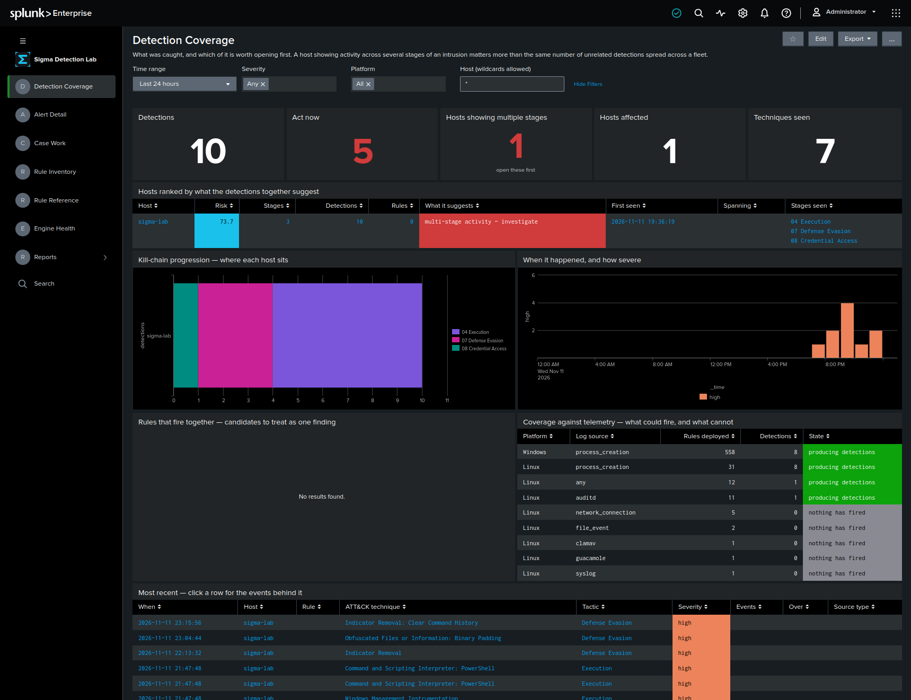

One host, ten detections, and the number that matters is **three stages**:
execution, defence evasion and credential access on the same machine. That is
what "multi-stage activity — investigate" is reading, and why this host
outranks one with more detections of a single kind. The telemetry panel on
the right is the other half of the question — which log sources are producing
detections and which are deployed but silent.

### 2. The triage queue

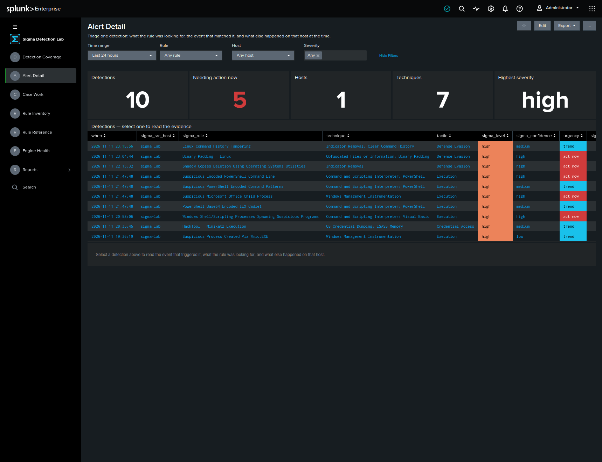

Ten detections, five needing action now. `urgency` is not the Sigma severity:
it combines severity with the confidence scored from the rule's own
declarations, so a severe rule whose author documented that it matches
legitimate work is recorded and baselined rather than put in front of
someone at 3am.

### 3. The evidence behind one detection

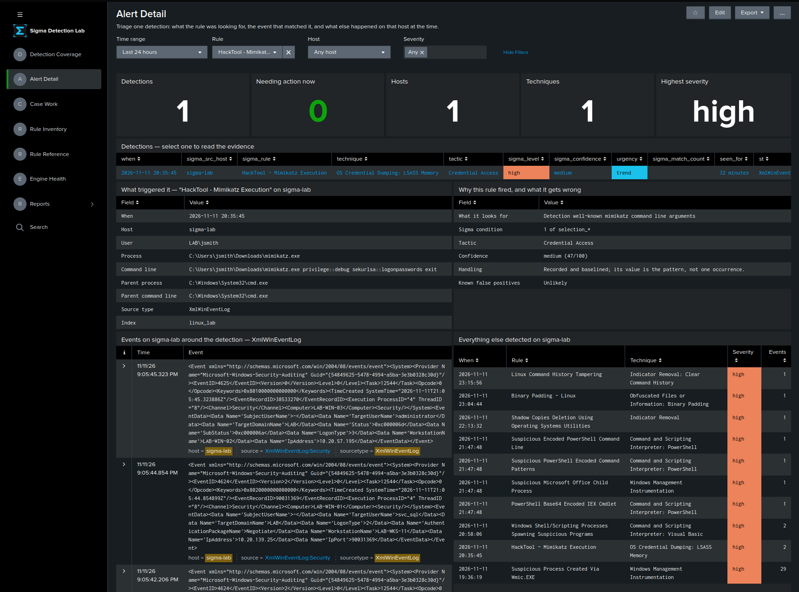

Select a row and the rest fills in. For Mimikatz: the user, the binary, and
the command line — `privilege::debug sekurlsa::logonpasswords` — with the
parent process, the Sigma condition that matched, the confidence and its
reasoning, the raw events around it on that host, and everything else
detected on the same machine. This is the page that answers "is this real",
without leaving it.

### 4. Working the case

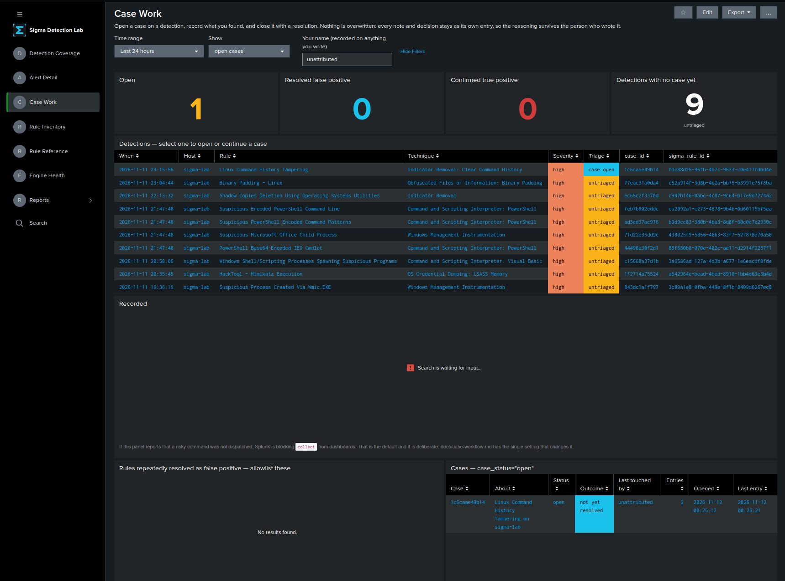

Open a case against a detection and record what you found. The journal is
append-only: every note and decision is its own entry, so the reasoning
outlives whoever wrote it. Rules repeatedly resolved as false positive
surface as allowlist candidates, which is how tuning gets decided from
evidence rather than from irritation.

### 5. Every rule deployed

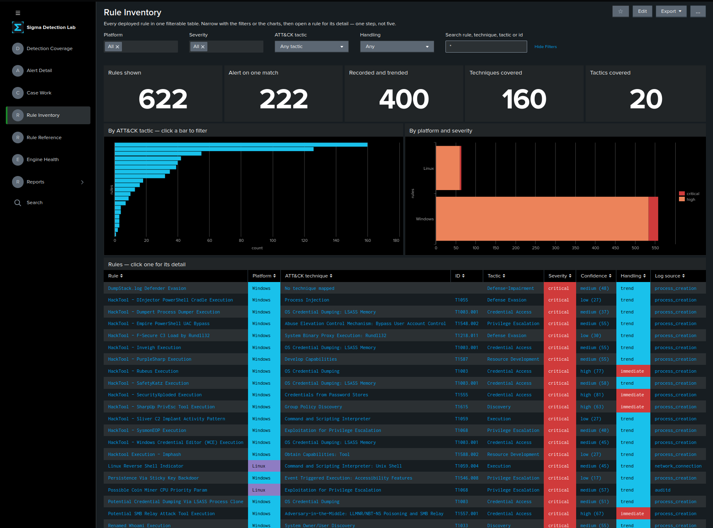

622 rules: 222 that alert on a single match, 400 recorded and trended, across
160 ATT&CK techniques and 20 tactics. Filter by platform, severity, tactic or
handling, or click a bar.

### 6. What a rule actually does

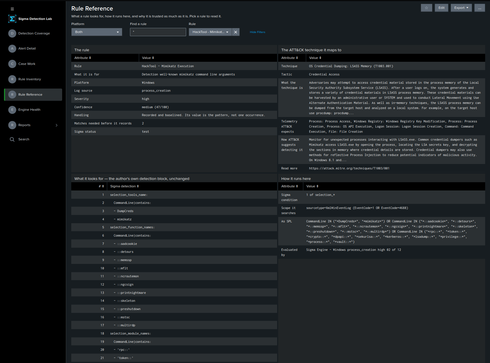

The rule, and the ATT&CK technique it maps to with the technique's own
description — what it is, the telemetry ATT&CK expects, and how ATT&CK
suggests detecting it.

*The same page, further down.*

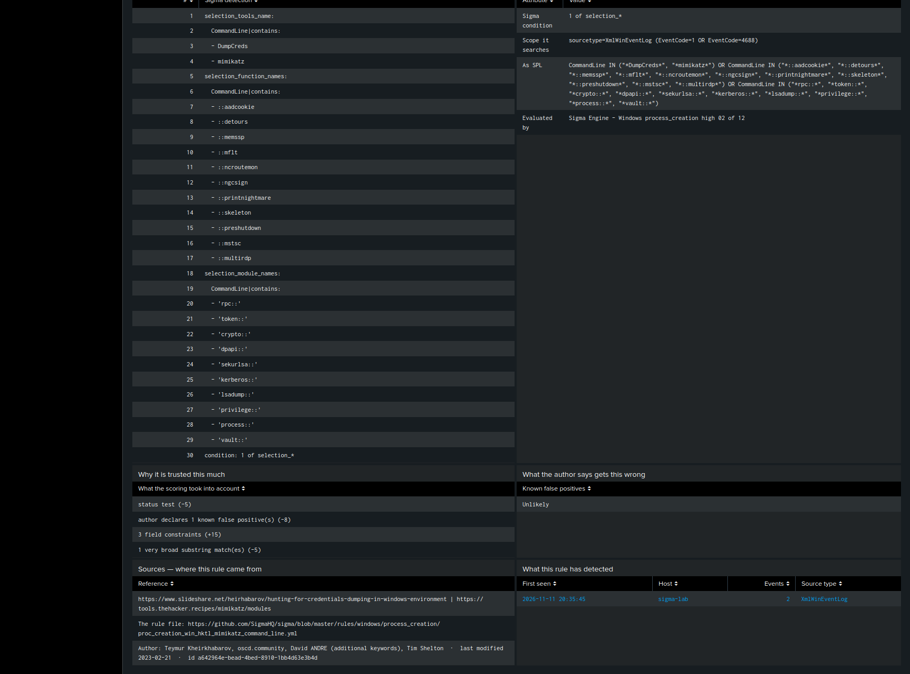

The author's detection block **unchanged**, the SPL it compiles
to, which batch evaluates it, how its confidence was scored line by line,
the false positives its author declared, and the source it came from. An
operator can satisfy themselves about a rule without reading the repository.

### 7. Whether the engine is healthy

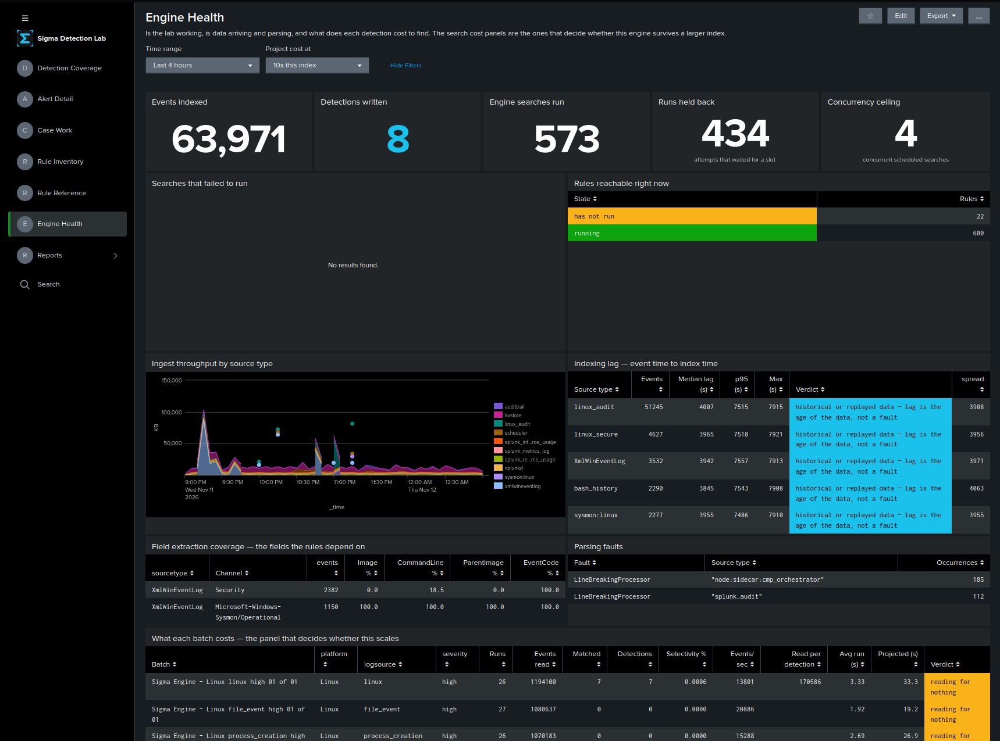

Events indexed, detections written, searches run, how many waited for a slot,
and the concurrency ceiling actually in force — four on this instance. The
lag table distinguishes replayed data, where lag is simply the age of the
events, from timestamp extraction having failed, where every event shares one
lag and every time-bounded detection breaks silently.

*The same page, further down.*

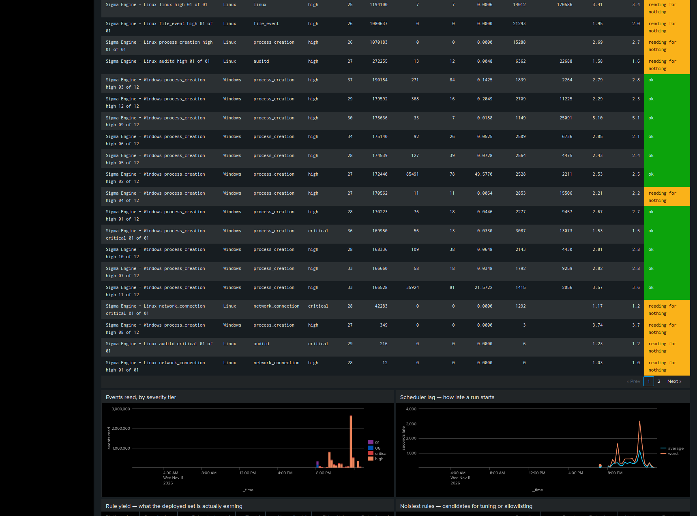

The panel that decides whether this scales: per batch, how many events it
read, how many it matched, its selectivity, and the projected cost at ten
times this index. Batches marked **reading for nothing** are scanning
millions of events for rules that never fire here — the first thing to cut
on a larger index.

### 8. Reporting

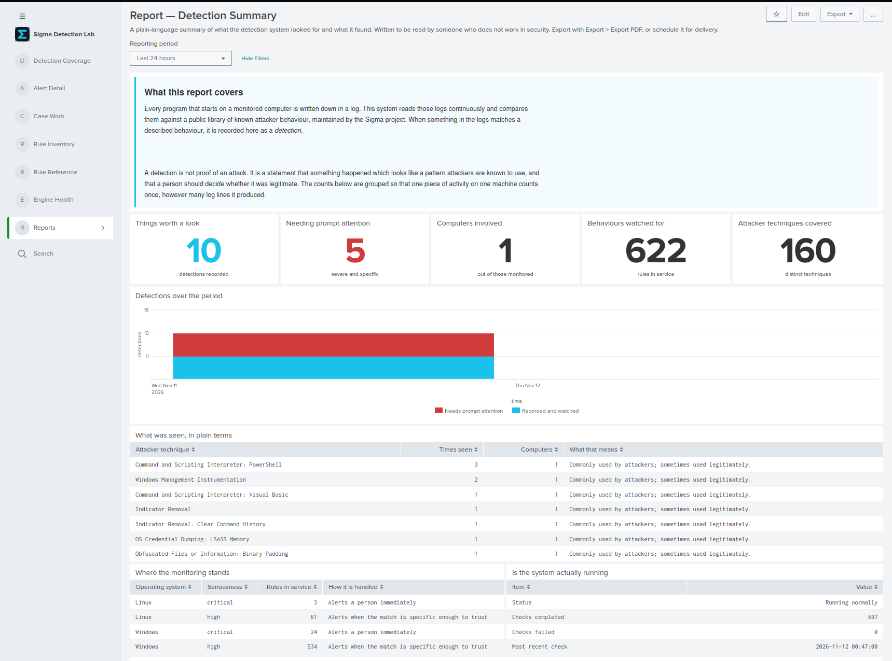

Written for someone who does not work in security: what the system looked
for, what it found, and what the techniques mean, with the counts grouped so
one piece of activity on one machine counts once however many log lines it
produced.

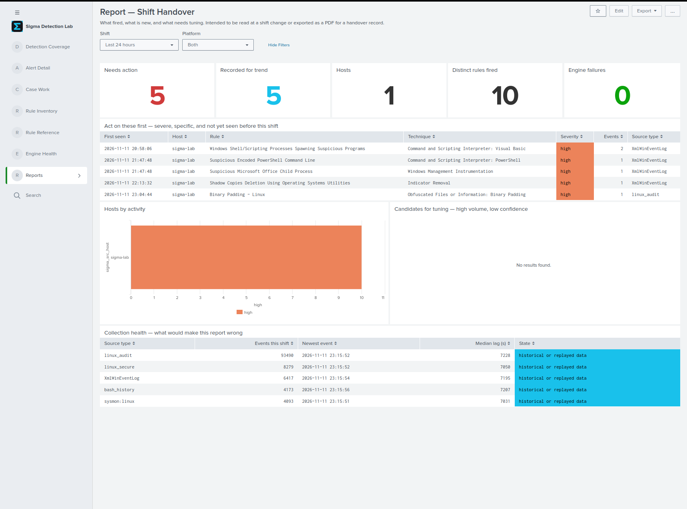

And for the next shift: what needs action, what is only being trended, what
fired for the first time, and a collection-health table saying what would
make the report wrong.

---

## What it does not do

- **Only the log sources it is mapped for.** 558 of 622 rules are Windows
  process creation. Registry, image load, PowerShell script block, cloud
  and network are not covered. `logsource-scope.yml` is where that is
  extended.
- **Sigma correlation rules are not supported.** Rules with a
  `correlation:` block are skipped.
- **It is not a ticketing system.** Case Work records the security
  decision and leaves workflow to whatever already owns it.
- **Writing a case entry needs one instance-wide setting.** Splunk blocks
  `collect` from dashboards by default, and the app does not ship around
  that; [docs/case-workflow.md](docs/case-workflow.md) has the argument.

---

## Reading further

| | |
|---|---|
| [docs/setup-guide.md](docs/setup-guide.md) | installing it, in six steps |
| [docs/configuration-spec.md](docs/configuration-spec.md) | every setting written, and why |
| [docs/case-workflow.md](docs/case-workflow.md) | the case journal, and the one setting it needs |
| [test/README.md](test/README.md) | what each validation phase proves, and what to do when one fails |
