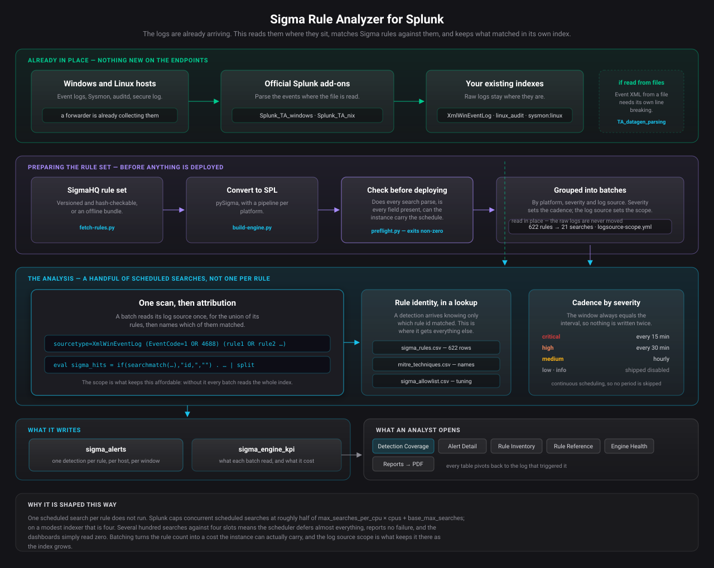

# Sigma rule analyzer for Splunk

A lightweight Sigma rule analyzer that runs inside Splunk. It takes the
Windows and Linux logs the official Splunk add-ons already collect, matches
them against Sigma detection rules, and writes what matched as a detection
event you can search, report on, and pivot from back to the log that
triggered it.

Nothing else has to be installed on the endpoints. If the Splunk Add-on for
Microsoft Windows or the Splunk Add-on for Unix and Linux is already
collecting, the data needed is already arriving.



| | |
|---|---|
| **What it reads** | the logs the official add-ons already collect, in the indexes they already sit in |
| **What it writes** | one detection per rule, per host, per window, into `sigma_alerts`, carrying the rule's identity, severity, ATT&CK mapping and the evidence |
| **What you open** | the `sigma_detection_lab` app — six views and two reports |
| **What it installs on endpoints** | nothing |
| **Rules deployed here** | 622 (558 Windows, 64 Linux) as 21 batched searches plus 22 standalone |

---

## How it works

**One scheduled search per rule does not run.** Splunk caps concurrent
scheduled searches near half of `max_searches_per_cpu × cpus +
base_max_searches` — four on a modest indexer. Against 561 of them the
scheduler deferred almost everything and nothing errored; the dashboards
simply read zero.

So rules are batched. A batch scans its log source once for the union of
its rules' conditions, then names which of them matched. Rule identity
lives in a lookup, so adding rules does not add searches.

```
Windows / Linux hosts
        |  the official add-ons collect and parse
        v
    raw index
        |  one scan per log source, then per-rule attribution
        v
  sigma_alerts            one detection per rule, per host, per window
        |                 with the rule's identity and the evidence
        v
  sigma_detection_lab     what fired, what it cost, and why it is trusted
```

The scope ahead of each batch is what keeps it affordable: measured here,
mapping a log source to where it is indexed cut a batch's read from 161,727
events to 12,396.

---

## Quick start

```bash
pip install -r requirements.txt -t ./pylib          # pySigma, vendored
./fetch-rules.py --package core                      # SigmaHQ, hash-checked
./bin/preflight.py rules-core/.../windows/process_creation rules-core/.../linux
./bin/package-app.sh --rules "rules-core/.../windows/process_creation rules-core/.../linux"
```

Install the `.spl` from `dist/`, restart splunkd, then prove it works in
your environment:

```bash
./test/run-all.sh --container <splunk> --uf <forwarder>
```

Six steps in full: [docs/setup-guide.md](docs/setup-guide.md).

---

## The tools

| | |
|---|---|
| [`bin/build-engine.py`](bin/build-engine.py) | converts rules and emits the batched searches and the lookups |
| [`bin/preflight.py`](bin/preflight.py) | checks a rule set **without Splunk** — conversion, ids, syntax, scope, fields, and whether the schedule fits the concurrency available |
| [`bin/check-instance.sh`](bin/check-instance.sh) | checks the instance — spool input, concurrency, indexes, where parsing happens |
| [`bin/field-inventory.sh`](bin/field-inventory.sh) | collects the fields an environment produces, for preflight to check against |
| [`bin/backfill.sh`](bin/backfill.sh) | runs the engine once across a wider window, so an instance that already holds months of logs is examined rather than waiting for new data |
| [`bin/package-app.sh`](bin/package-app.sh) | builds the installable `.spl` |
| [`bin/reset-lab-data.sh`](bin/reset-lab-data.sh) | empties a lab index and prunes what test rounds leave behind |
| [`test/run-all.sh`](test/run-all.sh) | the end-to-end proof: labelled data, rules, instance, detection at four levels of camouflage, and every dashboard panel |
| [`test/check-dataset.py`](test/check-dataset.py) | checks a labelled dataset against its own ground truth before anything is scored against it |

`preflight` exits non-zero, so it can gate a deployment. A check that could
not run reports as **skipped**, never as passed.

---

## Proving it works

A detection product that is quiet and one that is broken look identical
from the outside. [`test/`](test/README.md) is how you tell them apart: it
builds events a named rule must match, proves offline that they match, puts
them through the instance, and reports what came back.

| phase | what it proves |
|---|---|
| labelled data | the dataset agrees with its own ground truth, so the numbers below are safe to read |
| rule set | every rule converts, parses, is mapped, and the schedule fits |
| instance | detections can actually be written here |
| detection | a control round with nothing planted, then four tiers from obvious to one event in twelve thousand |
| dashboards | every panel search runs, with errors named |

Recall is the number usually quoted. **The control round is the one that
decides whether the app is usable** — nothing is planted, so anything it
detects is unambiguously a false positive.

---

## The views

| view | what it is for |
|---|---|
| **Detection Coverage** | what was caught and what to open first. Ranks hosts by severity weighted by the rule's own confidence and multiplied for breadth across kill-chain stages, because three detections crossing stages is an intrusion and ten of one kind is usually a noisy rule |
| **Alert Detail** | triage one detection: the event that matched, what the rule looked for, and what else happened on that host |
| **Case Work** | an append-only journal — open, note, evidence, resolve. Nothing is overwritten, so who decided what and why survives ([how](docs/case-workflow.md)) |
| **Rule Inventory** | every deployed rule, filterable, with technique names rather than ATT&CK identifiers |
| **Rule Reference** | one rule explained — the author's own detection block, the SPL it runs as, the technique, the confidence scoring, and the false positives its author declared |
| **Engine Health** | ingest, parsing, extraction coverage, and what each batch costs to run — the panel that decides whether this survives a larger index |
| **Reports** | Detection Summary for a general audience, Shift Handover for the queue. Both built for PDF export |

---

## What it does not do

- **Only the log sources it is mapped for.** 558 of 622 rules are Windows
  process creation. Registry, image load, PowerShell script block, cloud
  and network are not covered. `logsource-scope.yml` is where that is
  extended.
- **Sigma correlation rules are not supported.** Rules with a
  `correlation:` block are skipped.
- **It is not a ticketing system.** Case Work records the security
  decision and leaves workflow to whatever already owns it.
- **Writing a case entry needs one instance-wide setting.** Splunk blocks
  `collect` from dashboards by default, and the app does not ship around
  that; [docs/case-workflow.md](docs/case-workflow.md) has the argument.

---

## Reading further

| | |
|---|---|
| [docs/setup-guide.md](docs/setup-guide.md) | installing it, in six steps |
| [docs/configuration-spec.md](docs/configuration-spec.md) | every setting written, and why |
| [docs/case-workflow.md](docs/case-workflow.md) | the case journal, and the one setting it needs |
| [test/README.md](test/README.md) | what each validation phase proves, and what to do when one fails |
