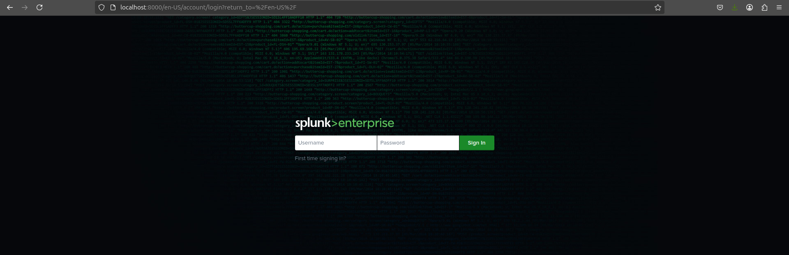
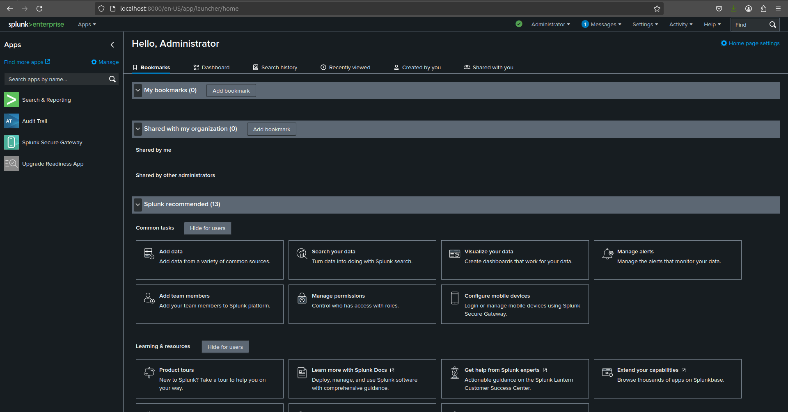

<p align="center">
  
</p>

---

Splunk Enterprise, a universal forwarder, and the connectors that feed them.

## Layout

| Path | What it is |
| --- | --- |
| `docker-compose.yml` | the full stack: indexer, forwarder, Traefik |
| `enterprise/` | Splunk Enterprise image (`Dockerfile`, `stig.Dockerfile`) |
| `universalforwarder/` | forwarder image, same two variants |
| `splunk__connectors/` | file-tailing connectors for CSV, JSON, XML, SQL, Parquet |
| `conf/` | hardened `.conf` **templates** plus `render.sh`, which turns them into deployable config |
| `quick_deploy/` | Terraform and Ansible for deploying to hosts |
| `apps/`, `enterprise/apps/`, `splunk-spec-files/` | vendor content, not edited here |

Both images pin Splunk **10.4.2** (build `33c3bf42cd73`). `ci/splunk-release-check.sh`
verifies every pin still resolves on download.splunk.com and that the images
agree on one version. A build string is specific to a single version, so if the
two images report different versions, one of the pins is wrong even when both
downloads succeed.

## System requirements

Mounted volumes must be on ext3, ext4, btrfs, XFS or NFS 3/4.

```bash
sudo ./sys_prep.sh
```

## Running the stack

```bash
cp .env.example .env      # set SPLUNK_PASSWORD and TRAEFIK_DASHBOARD_USERS
./conf/render.sh conf-rendered --server-name splunkenterprise.io \
    --allowed-domains example.com
podman compose up -d
```

`SPLUNK_PASSWORD` has no default. Every first-start configuration command
authenticates with it, including the one that enables the receiving port, so
without it the entrypoint exits rather than start a container it cannot
configure.

Confirm the memory limit reached the container. `deploy.resources` is Swarm
syntax, and some compose providers ignore it without reporting an error:

```bash
podman inspect -f '{{.HostConfig.Memory}}' splunkenterprise
```

Splunk Web is on <https://localhost:8000> — **https**, because the rendered
`web.conf` sets `enableSplunkWebSSL`. The Traefik dashboard is on
<https://dashboard.podman.localhost>.

## The hardened configuration

The files in `conf/` are templates, not deployable config: they carry
placeholders and reference certificates that do not exist. Nothing mounts them
in that form, so an instance started without the render step applies none of
their settings, including `enableSplunkWebSSL` and the `allowedDomainList` whose
absence Splunk warns about at startup.

`conf/render.sh <out-dir>` resolves the placeholders and writes deployable
files. Both compose files mount the result at
`/staged/conf`, and certificates at
`/staged/certs`; the entrypoint copies both into place
owned by `splunk` before splunkd starts. **Neither can be mounted at its final
path.** A mount over `etc/system/local` hides `passwords.conf` and destroys the
seeded admin login. A mount over `etc/auth/mycerts` carries the host's
ownership — root inside the container — which leaves the 0600 keys unreadable
by splunkd. Splunk Web then starts with SSL enabled and no usable certificate,
and serves no response.

An empty or missing `conf-rendered/` is not an error; the instance runs stock
defaults.

Two files are deliberately not rendered into `system/local`. `user-seed.conf`
conflicts with the password the entrypoint seeds on first start, and `splunk-launch.conf`
is read only from `$SPLUNK_HOME/etc`. A third, `outputs.conf`, needs
`--forwarding`: its `[indexAndForward] selectiveIndexing = true` is meant for
an instance that forwards to indexers. On an indexer it is total data loss:
HEC keeps answering `{"text":"Success","code":0}`, `metrics.log`
`name=index_thruput` stays at `ev=0`, and no index receives anything, `_internal`
included.

Certificates: generate them by any method, but the SANs must match the names
the config uses. `cribl/integration-lab/make-certs.sh` is a worked example that
produces a CA and per-service certificates and verifies each against it.

### Running the Splunk CLI in a container

Always as `splunk`:

```bash
podman exec -u splunk splunkenterprise /opt/splunk/bin/splunk status
```

`podman exec` defaults to root and the CLI writes as whoever runs it. A single
root-owned `etc/system/metadata/local.meta` stops splunkd from starting again
(`Cannot initialize: ... Permission denied`). The failure is not immediate:
splunkd first answers HTTP 500 on `/storage/passwords` while the container
still reports healthy.
Splunk 10 also refuses to start as root, so `podman exec <c> splunk restart`
stops splunkd and does not bring it back.

The image ships no `curl`, `wget`, `nc`, `ss`, `netstat` or `lsof`. Use a
`splunk` subcommand, `openssl`, or `/opt/splunk/bin/python3`.

## Building an image on its own

```bash
cd enterprise
podman build -t splunk .                      # Debian
podman build -t splunk -f stig.Dockerfile .   # AlmaLinux, STIG applied
```

## Connectors

`splunk__connectors/` tails files and posts them to HEC or to Elasticsearch.
The formats share `core/`, so offsets, schema matching, time coercion, retry
and HEC framing are implemented once.

```bash
cd splunk__connectors/uat && ./run-uat.sh
```

The suite runs against a mock HEC that enforces the same rules as a real HEC,
and validates that mock before it tests any connector: a receiver that accepts
anything reports a broken connector as healthy. See `splunk__connectors/README.md`.

<p align="center">
  
</p>

<p align="center">
  
</p>
